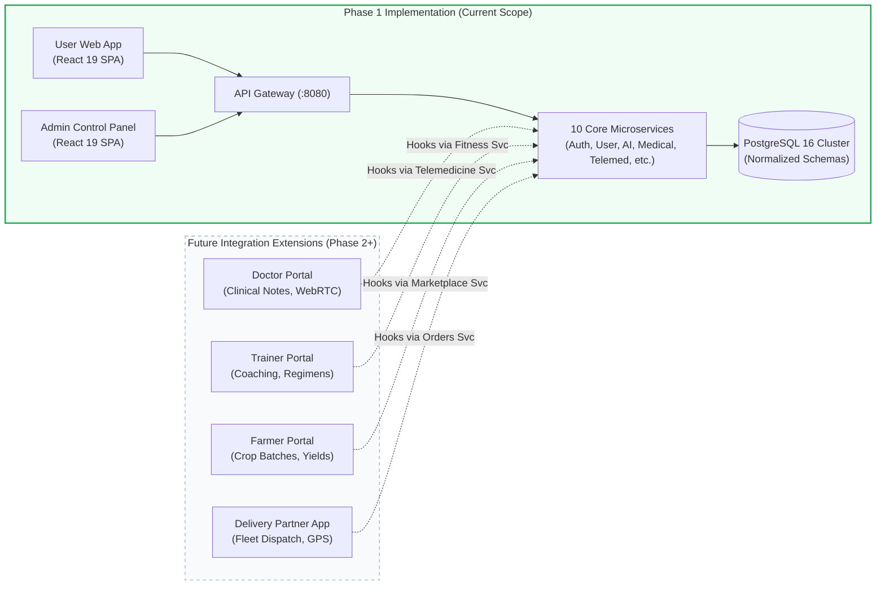
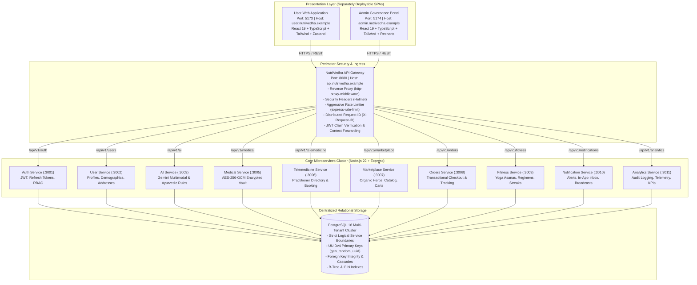
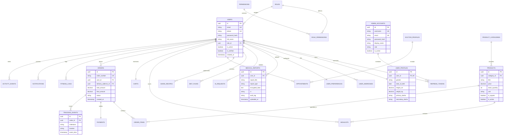
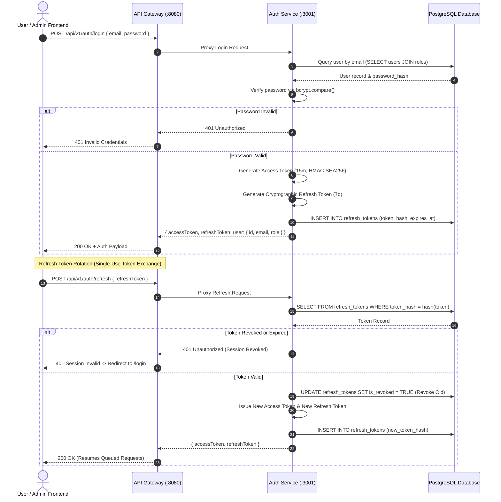

# 🌿 NutriVedha — Precision Ayurvedic Intelligence & Integrated HealthTech Ecosystem

[](https://nodejs.org/)
[](https://react.dev/)
[](https://www.typescriptlang.org/)
[](https://www.postgresql.org/)
[](https://www.prisma.io/)
[](docs/architecture/microservices-architecture.md)
[](docs/security/security-guidelines.md)
[](LICENSE)

> **Bridging 5,000 years of classical Ayurvedic wisdom with modern clinical artificial intelligence, microservices architecture, and enterprise-grade health data security.**

NutriVedha is an enterprise-grade HealthTech platform designed to deliver personalized, evidence-informed preventive healthcare. The ecosystem unifies classical Ayurvedic constitutional assessment (**Prakriti & Vikriti dosha analysis**), multimodal AI-assisted dermatological and symptom screening, clinical-grade encrypted personal health records (**AES-256-GCM**), budget-aware personalized nutrition, verified practitioner discovery, circadian yoga regimens, and a certified organic farm-to-home marketplace with end-to-end delivery tracking.

---

## 📑 Table of Contents

1. [Executive Summary & Architectural Motives](#1-executive-summary--architectural-motives)
2. [Phase 1 Development Scope vs Future Modules](#2-phase-1-development-scope-vs-future-modules)
3. [System Architecture & Topology](#3-system-architecture--topology)
4. [Microservices Responsibility Matrix](#4-microservices-responsibility-matrix)
5. [Database Architecture & Entity Ownership](#5-database-architecture--entity-ownership)
6. [Core System Workflows](#6-core-system-workflows)
7. [API Gateway & Route Contracts](#7-api-gateway--route-contracts)
8. [Enterprise Security & Clinical Data Protection](#8-enterprise-security--clinical-data-protection)
9. [UI/UX Design System & Experience Layer](#9-uiux-design-system--experience-layer)
10. [Repository Layout (Clean Monorepo)](#10-repository-layout-clean-monorepo)
11. [Step-by-Step Developer Execution Guide](#11-step-by-step-developer-execution-guide)
12. [Testing Strategy & Quality Gates](#12-testing-strategy--quality-gates)
13. [Complete Documentation Sitemap](#13-complete-documentation-sitemap)

---

## 1. Executive Summary & Architectural Motives

Modern healthcare is challenged by a systemic paradox: health-conscious individuals increasingly seek personalized, natural, and preventive wellness, yet existing software solutions are fundamentally fragmented:
- **Western-Centric Biases**: Prevailing nutrition and fitness platforms routinely ignore Ayurvedic constitutional typing (*Vata, Pitta, Kapha*), circadian biological clocks (*Dinacharya*), and seasonal bio-rhythms (*Ritucharya*).
- **Superficial Chatbot Gimmicks**: AI wellness apps often rely on toy chatbots with zero clinical context, no encrypted audit trails, and no integration with verified practitioners or authentic organic supply chains.
- **Legacy Insecurities**: Earlier iterations of health platforms suffered from monolithic spaghetti code, hardcoded administrative passkeys, insecure local storage caching, client-side role manipulation, and unverified mock APIs.

### The NutriVedha Solution
NutriVedha re-engineers the digital Ayurvedic paradigm from first principles into a **production-grade, decoupled microservices monorepo**:
- **Stateless Authentication Gate**: Replaces fragile client passkeys with HMAC-SHA256 JWT access tokens paired with single-use, server-revocable rotating refresh tokens stored in PostgreSQL.
- **Clinical-Grade Encryption at Rest**: Medical diagnostic records and symptom scans are encrypted with **AES-256-GCM** using unique 16-byte initialization vectors (IVs) and cryptographic authentication tags.
- **Resilient AI Inference**: Multimodal Google Gemini API integrations paired with deterministic rule-based classical Ayurvedic expert fallbacks ensure 100% platform availability.
- **Atomic Commerce**: Farm-to-home organic produce ordering executed through ACID database transactions across inventory, order items, payments, and sequential milestone tracking.

---

## 2. Phase 1 Development Scope vs Future Modules

To ensure high cohesion, reliability, and gradual production readiness, the NutriVedha architecture enforces strict phase boundaries:



### Strict Implementation Boundaries
1. **In-Scope (Phase 1)**:
   - **User Frontend**: Full patient & wellness seeker experience (registration, AI disease scan, 7-day Ayurvedic diet planner, recipe explorer, doctor discovery, organic marketplace, cart, checkout, 5-step delivery tracking, encrypted health vault, notifications).
   - **Admin Frontend**: Enterprise governance control panel (elevated authentication, user moderation & instant session revocation, global audit telemetry inspector, system broadcast dispatch, product stock & price control, microservice health monitor).
   - **Shared Microservices**: 10 independent backend services + API Gateway.
   - **Centralized PostgreSQL Database**: Single PostgreSQL 16 cluster hosting dedicated, isolated tables per service.
2. **Explicitly Out-of-Scope (Preserved Integration Hooks)**:
   - Dedicated practitioner EHR portals (Doctor Portal), trainer coaching consoles (Trainer Portal), cultivator wholesale dashboards (Farmer Portal), and courier live GPS telemetry applications (Delivery Portal).
   - *Architecture Preservation*: Foreign keys (`doctor_id`, `farmer_id`, `assigned_to`), database relations, and event hooks are formally preserved in the schema to ensure zero-refactor onboarding in Phase 2.

---

## 3. System Architecture & Topology

NutriVedha follows the **API Gateway Pattern** and **Domain-Driven Design (DDD)** over a unified relational data plane:



---

## 4. Microservices Responsibility Matrix

Every microservice is built as an independent, layered Node.js/TypeScript application (`src/{controllers,routes,services,repositories,validators,middleware,types}`):

| Service Name | Port | Base Path | Core Domain Responsibilities | Owned Database Entities |
|---|---|---|---|---|
| **API Gateway** | `8080` | `/` | Perimeter security, route dispatching, rate limiting, correlation ID injection, CORS enforcement | *Stateless (No persistent tables)* |
| **Auth Service** | `3001` | `/api/v1/auth` | User registration, login, JWT generation, refresh token rotation, logout, password resets | `users`, `admin_accounts`, `roles`, `permissions`, `role_permissions`, `refresh_tokens` |
| **User Service** | `3002` | `/api/v1/users` | User health profiles (Prakriti dosha, demographics), physical addresses, dietary preferences, account export & deletion | `user_profiles`, `user_addresses`, `user_preferences` |
| **AI Service** | `3003` | `/api/v1/ai` | Gemini multimodal symptom & image evaluation, 7-day budget-aware diet synthesis, pantry recipe generator, diagnostic audit trail | `ai_requests`, `diet_plans`, `saved_recipes` |
| **Medical Service**| `3005` | `/api/v1/medical` | AES-256-GCM encrypted health reports, diagnostic file references, cryptographic tamper verification | `medical_reports` |
| **Telemedicine** | `3006` | `/api/v1/telemedicine`| Verified doctor directory, practitioner profiles, appointment slot booking, cancellation management | `doctor_profiles`, `appointments` |
| **Marketplace** | `3007` | `/api/v1/marketplace`| Organic herb & crop catalog, category taxonomy, pricing, inventory stock levels, user wishlists, active carts | `product_categories`, `products`, `wishlists`, `carts` |
| **Orders Service**| `3008` | `/api/v1/orders` | Atomic cart checkout, order persistence, payment gateway status reconciliation, 5-step milestone tracking events | `orders`, `order_items`, `payments`, `tracking_events` |
| **Fitness Service**| `3009` | `/api/v1/fitness` | Classical yoga asanas, circadian workout routines, user activity logs, daily adherence streak calculations | `fitness_logs` |
| **Notification** | `3010` | `/api/v1/notifications`| User notification inbox, unread count polling, administrative system-wide broadcast dispatching | `notifications` |
| **Analytics** | `3011` | `/api/v1/analytics` | Admin KPI metrics aggregation, system audit trails, activity events telemetry, microservices health ping monitoring | `audit_logs`, `activity_events`, `system_settings` |

*Full specification available in [`docs/architecture/microservices-architecture.md`](docs/architecture/microservices-architecture.md).*

---

## 5. Database Architecture & Entity Ownership

NutriVedha leverages a centralized **PostgreSQL 16** engine using **UUIDv4** keys (`gen_random_uuid()`), enforcing strict service ownership boundaries. Cross-service database queries or direct table mutations outside the designated service are strictly prohibited.



*Schema DDL and Prisma models available in [`database/schema/initial_schema.sql`](database/schema/initial_schema.sql) and [`database/schema/schema.prisma`](database/schema/schema.prisma).*

---

## 6. Core System Workflows

### 1. Dual-Token Authentication & Refresh Token Rotation


### 2. User Journey: Multimodal Scan to Encrypted Health Vault
```text
1. User navigates to /scan in User Frontend.
2. User uploads dermatological photo and enters symptom description.
3. Client dispatches multipart request -> Gateway (:8080) -> AI Service (:3003).
4. AI Service queries Google Gemini 2.0 Flash; on network failure, activates classical rule fallback.
5. Analysis result (Prakriti imbalance, herbs, severity) saved in ai_requests and returned to user.
6. User clicks 'Save to Vault' -> Gateway (:8080) -> Medical Service (:3005).
7. Medical Service encrypts payload using AES-256-GCM (generating 16-byte random IV and auth tag).
8. Encrypted record committed to medical_reports table; viewable securely in /reports.
```

### 3. Administrative Governance & Instant Account Revocation
```text
1. Administrator authenticates at admin.nutrivedha.example (/admin/login).
2. Admin accesses /admin/users, searching target account by email or UUID.
3. Admin clicks 'Suspend Account' -> Gateway (:8080) -> User Service (:3002).
4. User Service sets users.is_active = FALSE.
5. User Service triggers internal event to Auth Service (:3001) -> UPDATE refresh_tokens SET is_revoked = TRUE.
6. Analytics Service (:3011) records immutable audit event: ADMIN_SUSPEND_USER.
7. Subsequent API calls by user fail on token expiry; refresh attempt rejected with 401 Unauthorized.
```

*Detailed specifications available in [`docs/workflows/`](docs/workflows/).*

---

## 7. API Gateway & Route Contracts

The API Gateway on port `:8080` serves as the sole reverse proxy for all client applications:

| Microservice Target | Gateway Ingress Path | Key API Operations | Role Access Gate |
|---|---|---|---|
| **Auth Service** | `/api/v1/auth/*` | `POST /register`, `POST /login`, `POST /admin/login`, `POST /refresh`, `POST /logout`, `GET /me` | Public / Bearer Token |
| **User Service** | `/api/v1/users/*` | `GET /profile`, `PUT /profile`, `GET /addresses`, `POST /addresses`, `POST /:id/status` (Suspend) | User / Admin |
| **AI Service** | `/api/v1/ai/*` | `POST /scan`, `POST /diet/generate`, `GET /diet/current`, `POST /recipes/recommend` | Authenticated User |
| **Medical Service** | `/api/v1/medical/*` | `POST /reports/upload`, `GET /reports`, `GET /reports/:id`, `DELETE /reports/:id` | Authenticated User |
| **Telemedicine** | `/api/v1/telemedicine/*` | `GET /doctors`, `GET /doctors/:id`, `POST /appointments`, `GET /appointments/my` | Public / User |
| **Marketplace** | `/api/v1/marketplace/*` | `GET /products`, `GET /products/:id`, `GET /cart`, `PUT /cart`, `POST /wishlist/:id` | Public / User |
| **Orders Service** | `/api/v1/orders/*` | `POST /checkout`, `GET /my-orders`, `GET /:id/tracking`, `GET /admin/all` | User / Admin |
| **Fitness Service** | `/api/v1/fitness/*` | `GET /workouts`, `POST /logs`, `GET /logs/my` | Public / User |
| **Notification** | `/api/v1/notifications/*`| `GET /`, `GET /unread-count`, `PATCH /:id/read`, `POST /broadcast` (Admin) | User / Admin |
| **Analytics** | `/api/v1/analytics/*` | `GET /overview`, `GET /audit-logs`, `GET /health-status` | Admin Only |

*Complete endpoint schemas, parameter contracts, and JSON envelopes available in [`docs/api/api-contracts.md`](docs/api/api-contracts.md).*

---

## 8. Enterprise Security & Clinical Data Protection

1. **Zero Frontend Secrets**:
   - Client applications (`frontend/user` and `frontend/admin`) consume only non-sensitive build-time configurations (`VITE_API_BASE_URL`).
   - All secret keys, database connection URIs, Gemini API tokens, JWT signing secrets, and encryption keys are strictly isolated within backend environments.
2. **Clinical Encryption at Rest (AES-256-GCM)**:
   - Encrypted data stored with a cryptographically secure 128-bit authentication tag and a 16-byte random IV. Any byte-level modification in PostgreSQL triggers an immediate decryption rejection.
3. **Defense-in-Depth & OWASP Compliance**:
   - **Schema Sanitization**: Every endpoint validates input shapes via strict Zod schemas, stripping unmapped attributes.
   - **SQL Injection Prevention**: Parameterized queries enforced across all Prisma and PostgreSQL operations.
   - **Aggressive Rate Limiting**: Token-bucket rate limiting (100 req/15min default; 5 req/15min on authentication routes).
   - **CORS Whitelisting**: Strict multi-origin whitelisting (`user.nutrivedha.example`, `admin.nutrivedha.example`). Wildcard origins (`*`) are disallowed in production.

*Complete security guide available in [`docs/security/security-guidelines.md`](docs/security/security-guidelines.md).*

---

## 9. UI/UX Design System & Dual Frontend Applications

NutriVedha enforces a natural, calm, human-centered, premium healthcare identity across both frontends. The visual identity rejects artificial neon colors, aggressive gradients, and generic templates in favor of a classical **Ayurvedic Earth-Tone Palette**:

### Mandatory Ayurvedic Earth-Tone Palette Tokens

| Token Name | Hex Code | HSL / CSS Variable | Primary Strategic Role |
|---|---|---|---|
| **Warm Ivory** | `#F7F5EF` | `bg-ivory` | Main application backdrop, content canvas |
| **Cream** | `#F1EBDD` | `bg-cream` | Secondary card fills, sidebar accents, active pill containers |
| **Soft Beige** | `#E9E1D3` | `border-soft-beige` | Structural borders, card boundaries, dividers |
| **Sand** | `#D5C3A5` | `border-sand` | Hover highlights, badge outlines, scrollbar thumbs |
| **Sage** | `#A8B09A` | `text-sage` | Muted clinical badges, secondary wellness highlights |
| **Olive** | `#737B52` | `bg-olive` | Secondary actions, charts, balanced Ayurvedic tags |
| **Forest Green** | `#35483A` | `bg-forest` | Primary branding, dominant CTAs, active route states |
| **Warm Brown** | `#806B55` | `text-warm-brown` | Body captions, timestamps, secondary typography |
| **Charcoal** | `#34342F` | `text-charcoal` | High-contrast readable typography, headings, tables |

---

### Dual Independent Frontend Architecture

Both web applications are fully decoupled, independent Single Page Applications (SPAs) built with **React 19**, **Vite 6**, **TypeScript 5.6**, and **Tailwind CSS 3.4**:

```mermaid
graph TD
    subgraph UserApp["1. User Web Application (frontend/user) — Port :5173"]
        direction TB
        UPublic["Public Landing (Home, About, Services, Developers, Contact)"]
        UAuth["User Auth (Signup, Login — Strictly No Admin Role)"]
        UDash["Patient Wellness Dashboard"]
        UAIScan["AI Multimodal Disease & Symptom Scan (/scan)"]
        URecipe["Ayurvedic Recipe Generator & 7-Day Dosha Diet Planner"]
        UTele["Doctor Discovery & Telemedicine Appointments"]
        UMkt["Organic Herb & Crop Marketplace, Cart & 5-Step Order Tracking"]
        UVault["AES-256 Encrypted Health Reports Vault"]
        USign["Indian Sign Language (ISL) Video Health Assistant"]
    end

    subgraph AdminApp["2. Admin Control Console (frontend/admin) — Port :5174"]
        direction TB
        AAuth["Admin Auth (Isolated Login, No Public Signup, RBAC)"]
        AControl["System Control Center (/admin-control) — Telemetry KPIs"]
        AUsers["User Directory (/admin/users) — Moderation & Statutory Deletion"]
        ARoles["RBAC Matrix (/admin/roles) — Permissions & Future Boundaries"]
        ACMS["Content CMS (/admin/content) — Banners, FAQs, Announcements"]
        AMarket["Apothecary Catalog (/admin/marketplace) — SKU & Stock Admin"]
        AOrders["Order Fulfillment (/admin/orders) — Logistics Milestones & AWB"]
        ANotif["Broadcast Center (/admin/notifications) — Mass Dispatcher"]
        AAnalytics["Telemetry & Reports (/admin/analytics) — Dosha Distributions"]
        AAudit["Immutable Audit Ledger (/admin/audit-logs) — Cryptographic Logs"]
        AMonitor["Service Mesh Monitoring (/admin/monitoring) — 11 Services Ping"]
        ASettings["Platform Governance (/admin/settings) — Maintenance Mode Gate"]
    end

    Gateway["Unified API Gateway Reverse Proxy (:8080/api/v1)"]

    UserApp -->|Configurable apiClient| Gateway
    AdminApp -->|Configurable apiClient| Gateway
    
    style UserApp fill:#F7F5EF,stroke:#35483A,stroke-width:2px
    style AdminApp fill:#F1EBDD,stroke:#737B52,stroke-width:2px
    style Gateway fill:#E9E1D3,stroke:#34342F,stroke-width:2px
```



#### Dual-Mode Mock & Microservice Client Pattern
Both frontends implement a clean, production-grade microservice client architecture. In `frontend/user` and `frontend/admin`, dedicated service modules (`authService`, `userService`, `aiService`, `ordersService`, etc.) handle network communication:
- When `VITE_USE_MOCK=false`: Requests route through the API Gateway at `http://localhost:8080/api/v1` to the underlying microservices.
- When `VITE_USE_MOCK=true`: Requests are fulfilled instantly by in-memory centralized mock repositories populated with realistic Ayurvedic clinical data, allowing 100% functional standalone frontend development and UX testing.

---

## 10. Repository Layout (Clean Monorepo)

The repository strictly enforces independent top-level directories:

```text
NutriVedha/
├── frontend/
│   ├── user/                    # Dedicated User SPA (Port 5173, React 19 + Vite + Tailwind)
│   │   ├── public/              # Static public assets
│   │   ├── src/
│   │   │   ├── components/      # Common UI (Button, Card, Input, Select, Modal, Badge) & Navigation
│   │   │   ├── layouts/         # PublicLayout.tsx, UserLayout.tsx
│   │   │   ├── pages/           # 27 User Pages (Home, Scan, Diet, Recipes, Telemedicine, Orders, etc.)
│   │   │   ├── routes/          # AppRoutes.tsx, PrivateRoute.tsx
│   │   │   ├── services/        # apiClient, mockData, authService, aiService, ordersService, etc.
│   │   │   ├── store/           # Zustand stores (useAuthStore, useCartStore, useSavedStore, etc.)
│   │   │   ├── styles/          # Tailwind directives, earth-tone scrollbars & cards
│   │   │   └── types/           # Domain TypeScript definitions
│   │   ├── package.json
│   │   └── vite.config.ts
│   │
│   └── admin/                   # Dedicated Enterprise Admin SPA (Port 5174, React 19 + Vite)
│       ├── public/              # Static public assets
│       ├── src/
│       │   ├── components/      # Common UI (DataTable, Pagination, Modal, Card, Badge) & Nav
│       │   ├── layouts/         # AdminLayout.tsx
│       │   ├── pages/           # 15 Admin Pages (Dashboard, Users, Roles, CMS, Orders, Audit, etc.)
│       │   ├── routes/          # AppRoutes.tsx, AdminPrivateRoute.tsx
│       │   ├── services/        # apiClient, mockData, adminAuthService, adminUserService, etc.
│       │   ├── store/           # Zustand stores (useAdminAuthStore, useAdminNotificationStore)
│       │   ├── styles/          # Tailwind directives & earth-tone styling
│       │   └── types/           # Enterprise admin, RBAC, order, and telemetry types
│       ├── package.json
│       └── vite.config.ts
│
├── backend/
│   ├── gateway/                 # API Gateway on port 8080 (Reverse Proxy & Ingress)
│   ├── shared/                  # Common backend library (DB pool, cipher, errors)
│   ├── packages/                # Internal monorepo packages (shared-types, shared-validation)
│   ├── services/                # 10 Independent Microservices (auth, user, ai, etc.)
│   ├── docker-compose.yml       # Local container orchestration
│   └── tsconfig.base.json       # Monorepo TypeScript configuration
├── database/
│   ├── schema/                  # Master PostgreSQL DDL (initial_schema.sql) & Prisma schema
│   ├── migrations/              # Sequential timestamped SQL migrations
│   ├── seed/                    # Baseline seed data (roles, verified doctors, herbs)
│   └── README.md                # Database operations manual
├── docs/                        # Complete technical documentation suite (25 files)
├── scripts/                     # Automation, scaffolding, and database utility scripts
├── .env.example                 # Committed template of environment variables
├── .gitignore                   # Git exclusion rules
├── package.json                 # Monorepo workspaces root configuration
└── README.md                    # Primary master documentation (You are here)
```

---

## 11. Step-by-Step Developer Execution Guide

### 1. Prerequisites
- **Node.js**: `v20.x` or `v22.x LTS` (Node 22 LTS verified)
- **npm**: `v10.x+` (npm 12 LTS verified)
- **Docker & Docker Compose**: `v24.x+` (for containerized PostgreSQL)
- **PostgreSQL**: `v16.x` (Local or Docker on `:5432`)

---

### 2. Standalone Frontend Execution (Zero Docker / Zero DB Required)

Both `frontend/user` and `frontend/admin` are equipped with a toggleable, realistic in-memory microservice client repository (`VITE_USE_MOCK=true`). You can run and test both applications immediately without starting backend containers or databases:

#### Terminal 1 — User Frontend (Port 5173)
```bash
# Navigate to User frontend
cd frontend/user

# Install dependencies (use legacy-peer-deps for React 19 packages)
npm install --legacy-peer-deps

# Start Vite development server on port 5173
npm run dev
```
- Open browser: `http://localhost:5173`
- **Default Test User**: Auto-logs in or use `aarav.varma@example.com` / `Password123!`
- **Explore**: 
  - AI Disease & Symptom Scan (`/scan`)
  - 7-Day Dosha Diet Planner (`/diet`)
  - Ayurvedic Recipe Generator (`/recipes`)
  - Food Intelligence Database (`/food-intel`)
  - Telemedicine Doctor Directory (`/telemedicine`)
  - Certified Organic Marketplace, Cart & Checkout (`/marketplace`, `/cart`, `/checkout`)
  - 5-Step Order Milestone Tracking (`/orders/ord_9921/track`)
  - Indian Sign Language (ISL) Video Health Assist (`/sign-ai`)
  - AES-256 Encrypted Health Reports Vault (`/reports`)

#### Terminal 2 — Enterprise Admin Frontend (Port 5174)
```bash
# Navigate to Admin frontend
cd frontend/admin

# Install dependencies
npm install --legacy-peer-deps

# Start Vite development server on port 5174
npm run dev
```
- Open browser: `http://localhost:5174`
- **Available Development Test Accounts** (Quick-fill buttons available on login screen):
  | Role | Admin Email | Default Password | Scoped Permissions |
  |---|---|---|---|
  | **Super Admin** | `admin@nutrivedha.com` | `Admin@Nutri2026` | Full Unrestricted Access (`*`) |
  | **System Operator** | `ops@nutrivedha.com` | `Admin@Nutri2026` | Users, Marketplace, Orders, Monitoring |
  | **Content Manager** | `content@nutrivedha.com` | `Admin@Nutri2026` | Content CMS, Banners, FAQs, Broadcasts |
  | **Compliance Officer** | `compliance@nutrivedha.com` | `Admin@Nutri2026` | Audit Logs, Statutory Deletion Reviews |

---

### 3. Full Monorepo Execution (Shared Microservices & PostgreSQL)

To run the complete production topology with the API Gateway and backend services:

```bash
# Step 1: Copy environment variables template
cp .env.example .env

# Step 2: Spin up PostgreSQL 16 Cluster using Docker Compose
npm run db:up

# Step 3: Verify PostgreSQL is accepting connections
docker compose -f backend/docker-compose.yml exec postgres pg_isready -U postgres

# Step 4: Run database schema migration & baseline seed
psql -h localhost -p 5432 -U postgres -d nutrivedha -f database/schema/initial_schema.sql

# Step 5: Switch frontends from Mock Mode to Gateway Mode
# In frontend/user/.env and frontend/admin/.env:
# Set: VITE_USE_MOCK=false
# Set: VITE_API_BASE_URL=http://localhost:8080/api/v1

# Step 6: Boot API Gateway (:8080) and all 10 Microservices
npm run dev:backend

# Step 7: Boot User Application (:5173) and Admin Application (:5174)
npm run dev:user
npm run dev:admin
```

---

### 4. End-to-End Cross-Application Integration Testing Workflows

| # | Cross-Application Scenario | Execution Steps in User App | Execution Steps in Admin App |
|---|---|---|---|
| **1** | **Herbal Apothecary Purchase & Milestone Dispatch** | Add *KSM-66 Ashwagandha* to cart (`/cart`) -> Proceed to `/checkout` -> Place Order `NV-2026-9921`. | Go to `/admin/orders` -> Open `NV-2026-9921` -> Click **Update Fulfillment** -> Set status to `SHIPPED`, enter AWB `NV-TRK-774129` -> Click Commit. User delivery tracking updates instantly. |
| **2** | **Patient Account Moderation & Governance** | Logged in as User `usr_003` -> Browse platform. | Admin navigates to `/admin/users` -> Search `usr_003` -> Click **Modify Status** -> Set to `SUSPENDED` with audit reason. Token is instantly revoked in Auth Service. |
| **3** | **Seasonal Ritucharya CMS Banner Deployment** | User opens landing page (`/`). | Admin navigates to `/admin/content` -> Create New Banner with status `PUBLISHED` -> Banner immediately appears on User homepage carousel. |
| **4** | **System Broadcast Mass Alert** | User navigates to Notification Inbox (`/notifications`). | Admin opens `/admin/notifications` -> Click **Compose Broadcast** -> Select category `WELLNESS`, audience `ALL_USERS` -> Dispatch alert. User receives real-time broadcast card. |
| **5** | **Emergency Maintenance Mode Gate** | User navigates to any service route. | Admin opens `/admin/settings` -> Click **Activate Maintenance Holding Page** -> Confirm. Public User application displays maintenance splash while Admin retains full bypass access. |

---

## 12. Testing Strategy & Quality Gates

NutriVedha employs a disciplined testing pyramid:
- **Unit Testing (Vitest / Jest)**: Tests business rules, dosha macro calculations, Zod validators, and cryptographic cipher utilities.
- **Integration Testing (Supertest + Testcontainers)**: Verifies API Gateway proxying, database transactions, and rollback behavior.
- **End-to-End Testing (Playwright)**: Validates complete user journeys (Registration → AI Disease Scan → Cart Checkout → Delivery Tracking) and administrative governance flows (Login → User Suspension → Instant Lockout).

```bash
# Execute backend test suites
cd backend
npm run test
```

*Complete test specifications available in [`docs/testing/testing-strategy.md`](docs/testing/testing-strategy.md).*

---

## 13. Complete Documentation Sitemap

All architectural specifications, workflows, and operations manuals are indexed in [`docs/`](docs/):

| Document | File Path | Focus Area |
|---|---|---|
| **Project Overview** | [`docs/architecture/project-overview.md`](docs/architecture/project-overview.md) | Vision, objectives, high-level architecture |
| **Project Requirements** | [`docs/architecture/project-requirements.md`](docs/architecture/project-requirements.md) | Scope boundaries, functional requirements |
| **Architecture Overview** | [`docs/architecture/architecture-overview.md`](docs/architecture/architecture-overview.md) | ADRs, design patterns, communication styles |
| **Microservices Architecture**| [`docs/architecture/microservices-architecture.md`](docs/architecture/microservices-architecture.md) | 10 Services + Gateway, responsibilities, ports |
| **Root Folder Structure** | [`docs/architecture/root-folder-structure.md`](docs/architecture/root-folder-structure.md) | Directory breakdown and file conventions |
| **Frontend Architecture** | [`docs/architecture/frontend-architecture.md`](docs/architecture/frontend-architecture.md) | React 19, Zustand, route guards, state |
| **Backend Architecture** | [`docs/architecture/backend-architecture.md`](docs/architecture/backend-architecture.md) | Layered patterns, controller-service-repo |
| **Future Module Integration**| [`docs/architecture/future-module-integration.md`](docs/architecture/future-module-integration.md) | Preserved boundaries for Doctor, Farmer, etc. |
| **Database Architecture** | [`docs/database/database-architecture.md`](docs/database/database-architecture.md) | PostgreSQL 16, table ownership, indexing |
| **Database ER Diagram** | [`docs/database/database-er-diagram.md`](docs/database/database-er-diagram.md) | Complete Mermaid ER schema diagram |
| **User Workflow** | [`docs/workflows/user-workflow.md`](docs/workflows/user-workflow.md) | Patient & consumer wellness journey |
| **Admin Workflow** | [`docs/workflows/admin-workflow.md`](docs/workflows/admin-workflow.md) | Governance, user suspension, broadcasts |
| **Authentication Workflow** | [`docs/workflows/authentication-workflow.md`](docs/workflows/authentication-workflow.md) | JWT, refresh tokens, RBAC permissions |
| **Data Synchronization** | [`docs/workflows/data-synchronization.md`](docs/workflows/data-synchronization.md) | Cross-service data paths & ACID mutations |
| **API Contracts** | [`docs/api/api-contracts.md`](docs/api/api-contracts.md) | Complete REST route catalog & JSON schemas |
| **Security Guidelines** | [`docs/security/security-guidelines.md`](docs/security/security-guidelines.md) | AES-256-GCM cipher, zero-trust policies |
| **CORS & Deployment** | [`docs/deployment/cors-and-deployment.md`](docs/deployment/cors-and-deployment.md) | Multi-domain topology, Docker, cloud hosting |
| **UI/UX Design System** | [`docs/design-system/ui-ux-design-system.md`](docs/design-system/ui-ux-design-system.md) | Color tokens, glassmorphism, typography |
| **Component Inventory** | [`docs/design-system/component-inventory.md`](docs/design-system/component-inventory.md) | Reusable atomic and feature component specs |
| **User Feature Inventory** | [`docs/design-system/user-feature-inventory.md`](docs/design-system/user-feature-inventory.md) | Exhaustive list of User module capabilities |
| **Admin Feature Inventory**| [`docs/design-system/admin-feature-inventory.md`](docs/design-system/admin-feature-inventory.md) | Exhaustive list of Admin module capabilities |
| **Testing Strategy** | [`docs/testing/testing-strategy.md`](docs/testing/testing-strategy.md) | Multi-tier testing pyramid & CI/CD checks |
| **Development Roadmap** | [`docs/checklists/development-roadmap.md`](docs/checklists/development-roadmap.md) | Phase 1 Gantt timeline & milestones |
| **Task Management (WBS)** | [`docs/task-management/task-management.md`](docs/task-management/task-management.md) | Work breakdown structure with task IDs |
| **Phase Completion Checklist**| [`docs/checklists/phase-completion-checklist.md`](docs/checklists/phase-completion-checklist.md)| Definition of Done & quality acceptance |

---

**© 2026 NutriVedha Systems — Precision in Every Grain.**
