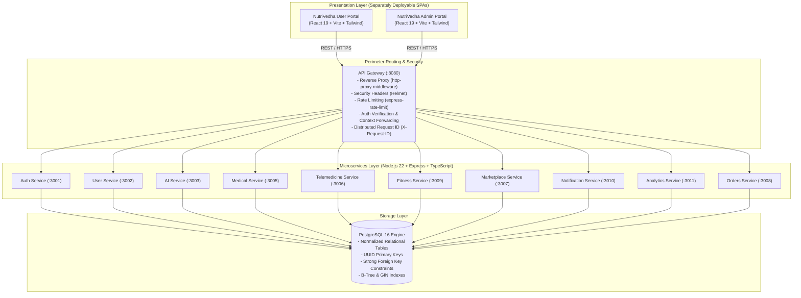

# NutriVedha — Architecture Overview

## 1. Architectural Style & Paradigms
NutriVedha is engineered using a **Distributed Microservices Architecture** unified by an **API Gateway Pattern**, paired with **Domain-Driven Design (DDD)** principles and a **Shared Database Pattern** with strict logical boundary segregation.

---

## 2. Core Architectural Decisions (ADRs)

### ADR-01: Independent Top-Level Directory Separation
- **Context**: The previous codebase suffered from monolithic coupling where frontends, backends, and multiple experimental modules shared overlapping folders.
- **Decision**: Enforce three mandatory top-level directories:
  - `frontend/`: Holds isolated `user` and `admin` SPA applications.
  - `backend/`: Hosts independent microservices, gateway, and shared libraries.
  - `database/`: Houses consolidated migration scripts, schema definitions, and seed data.
- **Consequence**: Clear isolation, independent CI/CD pipelines, and simplified dependency management.

### ADR-02: Microservices with Single Centralized PostgreSQL Database
- **Context**: Full database-per-service creates operational complexity and distributed transaction overhead for a Phase 1 team. However, a monolithic database with arbitrary joins creates spaghetti coupling.
- **Decision**: Utilize **one PostgreSQL 16 server** where each microservice possesses strict logical ownership over its dedicated tables. Cross-service database queries and direct foreign-service table writes are strictly prohibited in application code.
- **Consequence**: Streamlined backups, cost efficiency, single migration runner, while maintaining strict domain encapsulation.

### ADR-03: API Gateway as the Single Public Ingress
- **Context**: Exposing 10 microservice ports directly to browsers causes CORS nightmares, complex token refresh logic, and security exposure.
- **Decision**: Route all client traffic through a single Gateway on port `:8080`.
- **Consequence**: The frontend interacts with a single base URL (`/api/v1/*`), while the gateway handles SSL termination, CORS, rate-limiting, and header sanitization.

### ADR-04: Stateless JWT Authentication with Server-Side Refresh Tokens
- **Context**: Insecure hardcoded passkeys and client-side role manipulation plagued the legacy codebase.
- **Decision**: Implement short-lived Access Tokens (15 minutes) signed with HMAC-SHA256 containing user ID and verified role. Refresh tokens (7 days) are cryptographically hashed and stored in PostgreSQL (`refresh_tokens` table), enabling instant session revocation.
- **Consequence**: Eliminates security holes, enforces role-based access control (RBAC), and supports immediate account lockouts.

### ADR-05: Authenticated AES-256-GCM Encryption for Medical Records
- **Context**: Patient diagnostic information and scan reports must comply with clinical privacy standards.
- **Decision**: Encrypt all sensitive health reports using AES-256-GCM with a secret key sourced from environment variables.
- **Consequence**: High-performance encryption at rest with tamper-evident cryptographic authentication tags.

---

## 3. Communication Patterns

| Communication Path | Pattern | Protocol | Rationale |
|---|---|---|---|
| Frontend to Gateway | Request-Response | HTTPS / JSON REST | Standard, cache-friendly, universal browser support. |
| Gateway to Microservices | Reverse Proxy | HTTP/1.1 Internal | Low latency, non-blocking asynchronous proxying. |
| Inter-Service Synchronous | Internal REST API | HTTP/1.1 JSON | Explicit, typed contracts with timeout handling. |
| Cross-Service Asynchronous | Event Logging / Outbox | PostgreSQL Table Events | Reliable event logging without requiring high-maintenance Kafka/RabbitMQ in Phase 1. |
