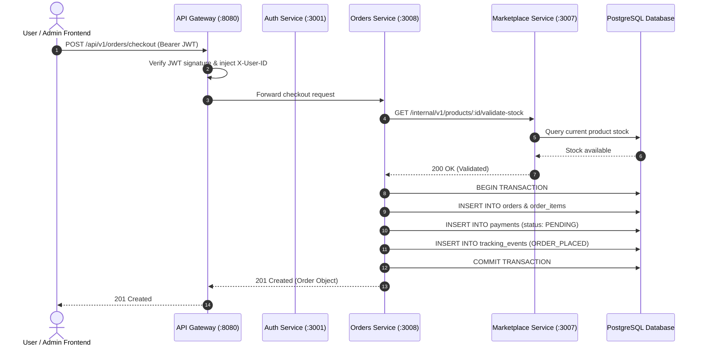

# NutriVedha — Backend Architecture Specification

## 1. Architectural Principles
1. **Domain-Driven Service Independence**: Every microservice encapsulates a cohesive business domain. A service never reaches into another service's internal directories.
2. **Standardized Layering**:
   - **Controller Layer**: Handles HTTP protocol serialization, deserialization, status codes, and delegates directly to the Service Layer.
   - **Service Layer**: Contains 100% of the business logic, rule validations, calculations, and transaction orchestration.
   - **Repository Layer**: Encapsulates raw database queries and Prisma ORM data-access methods.
   - **Validator Layer**: Implements Zod validation to parse and validate incoming request bodies, query params, and route parameters before execution reaches controllers.
3. **Resilient Gateway Proxying**:
   - The Gateway uses `http-proxy-middleware` with dedicated route prefix matching.
   - Injects `X-Request-ID` and `X-Forwarded-For` into every downstream microservice call.
   - Sanitizes and validates `Authorization: Bearer <token>` before forwarding authenticated user context (`X-User-ID`, `X-User-Role`) to internal services.

---

## 2. Inter-Service Communication & Fault Tolerance



---

## 3. Error Handling Standard
All services utilize a unified error envelope format:
```json
{
  "success": false,
  "error": {
    "code": "INSUFFICIENT_STOCK",
    "message": "Product Ashwagandha Churna currently has insufficient stock.",
    "details": [
      { "field": "quantity", "issue": "Requested 5 but only 2 available" }
    ],
    "requestId": "req_f81d4fae-7dec-11d0-a765-00a0c91e6bf6",
    "timestamp": "2026-11-22T15:35:10.124Z"
  }
}
```
Standard HTTP status codes are strictly adhered to:
- `200 OK` / `201 Created`
- `400 Bad Request` (Zod validation failure)
- `401 Unauthorized` (Missing or invalid JWT)
- `403 Forbidden` (Insufficient role permissions)
- `404 Not Found` (Resource does not exist)
- `409 Conflict` (Duplicate record / concurrency error)
- `422 Unprocessable Entity` (Domain business rule violation)
- `429 Too Many Requests` (Rate limit exceeded)
- `500 Internal Server Error` (Unexpected unhandled exception)
