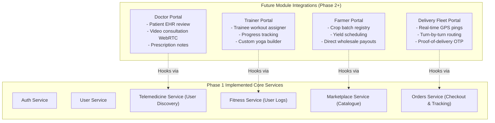

# NutriVedha — Future Module Integration Architecture

## 1. Integration Boundary Strategy
NutriVedha's Phase 1 architecture strictly isolates the **User** and **Admin** ecosystems while deliberately preserving standard integration hooks for the remaining four future modules:
1. **Doctor Module** (Practitioner Portal)
2. **Trainer Module** (Coach Portal)
3. **Farmer Module** (Organic Cultivator Portal)
4. **Delivery Module** (Logistics & Fleet Portal)

---

## 2. Module Boundary Contracts

### A. Doctor Module Boundary
- **Current State**: Phase 1 includes `doctor_profiles` and `appointments` tables. The User frontend browses doctors and schedules bookings.
- **Future Integration**: The Doctor Portal will authenticate via `Auth Service` with `role: "Doctor"`. It will consume the existing `appointments` table and write clinical consultation notes into `consultation_notes` without altering the User appointment schema.

### B. Trainer Module Boundary
- **Current State**: Phase 1 maintains `fitness_logs` and standard workout libraries in the Fitness Service.
- **Future Integration**: The Trainer Portal will bind to specific users through an `assigned_trainer_id` relation, allowing coaches to inject curated workout schedules directly into the user's fitness feed.

### C. Farmer Module Boundary
- **Current State**: Phase 1 manages organic produce and herbs in `products` and `product_categories` via the Marketplace Service.
- **Future Integration**: The Farmer Portal will expose batch harvesting logs and inventory injection APIs directly into `products` using `farmer_id` ownership, eliminating hardcoded product catalogs.

### D. Delivery Module Boundary
- **Current State**: Phase 1 tracks delivery milestones via `tracking_events` in the Orders Service.
- **Future Integration**: The Delivery Partner application will post real-time milestone transitions (`PICKED_UP`, `OUT_FOR_DELIVERY`, `DELIVERED`) and geographic coordinate updates to `/api/v1/orders/:id/tracking`, seamlessly updating the User delivery tracking timeline.
