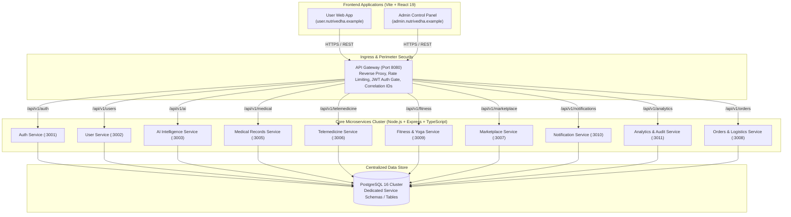

# NutriVedha — Project Overview

## 1. Executive Summary
**NutriVedha** is an enterprise-grade, precision Ayurvedic intelligence and integrated HealthTech ecosystem that bridges 5,000 years of traditional Ayurvedic principles with modern clinical artificial intelligence, microservices architecture, and secure personal health record management.

The platform eliminates the dichotomy between traditional wellness wisdom and scientific evidence-based digital health. NutriVedha delivers:
- Precision Prakriti (constitution) and Vikriti (imbalance) dosha assessments.
- AI-driven non-invasive symptom and dermatological image screening with confidence scores.
- Clinical-grade encrypted medical records vault (AES-256-GCM).
- Budget-aware, dosha-aligned personalized nutrition, diet, and recipe intelligence.
- Telemedicine consultations and verified practitioner discovery.
- Ayurvedic lifestyle, yoga routines, and circadian fitness regimens.
- Farm-to-home organic produce and Ayurvedic medicinal herbs marketplace with end-to-end order delivery tracking.
- Centralized administrative governance, audit trails, and telemetric oversight.

---

## 2. Strategic Objectives
1. **Holistic Modernization of Ayurveda**: Modernize classical Ayurvedic diagnosis using machine learning without diluting traditional diagnostic authenticity.
2. **Clinical Security & Privacy First**: Safeguard sensitive patient records with authenticated encryption at rest and role-based access control.
3. **Decoupled Scalability**: Architect an independent, microservices-driven backend orchestrated through an API Gateway, facilitating continuous delivery and zero-downtime scaling.
4. **Transparent Farm-to-Home Supply Chain**: Connect verified organic cultivators directly to health-conscious consumers for pure, unadulterated herbs and medicinal produce.
5. **Phase-Gated Development**: Establish a rock-solid foundation for the **User** and **Admin** ecosystems in Phase 1, preserving clear domain boundaries for future Doctor, Trainer, Farmer, and Delivery Partner portals.

---

## 3. High-Level System Landscape

---

## 4. Architectural Tenets
- **Zero Frontend Secrets**: Secrets, cryptographic keys, and database credentials remain strictly within backend microservices and secure vault environments.
- **Stateless Authorization**: JWT with cryptographically secure asymmetric or HMAC-SHA256 signatures paired with server-managed refresh token rotation.
- **Dedicated Data Ownership**: While leveraging a unified PostgreSQL 16 cluster, each microservice strictly owns its domain tables and data access constraints.
- **Fail-Safe Graceful Degradation**: Real AI capabilities with deterministic fallbacks prevent downtime if upstream AI or external APIs experience transient network failure.
