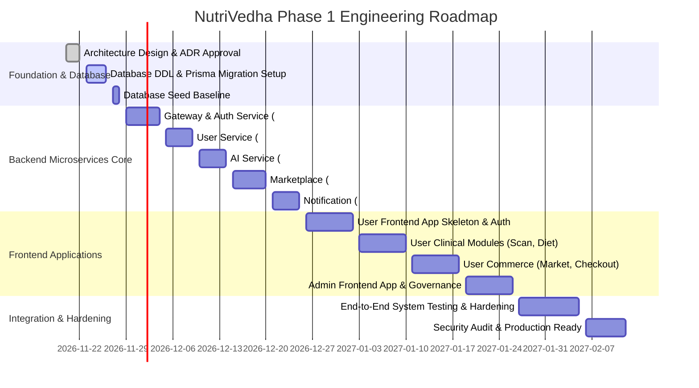

# NutriVedha — Development Roadmap (Phase 1)

## Phase 1 Execution Timeline

---

## Milestone Milestones
- **M1: Core Engine & Data Plane Ready** — PostgreSQL schema migrated, Auth and User services running behind Gateway with verified JWT generation.
- **M2: Clinical & AI Intelligence Operational** — Medical AES vault encrypted and AI scan service responding with live/fallback payloads.
- **M3: End-to-End Commerce Flow Verified** — Marketplace catalog browse -> Add to Cart -> Checkout -> Orders record created -> 5-step delivery tracker active.
- **M4: Admin Governance Active** — Admin can inspect live user audit logs, suspend accounts, and dispatch system-wide broadcasts.
- **M5: Phase 1 Production Sign-off** — 100% of integration test suites green, zero high-severity security findings.
