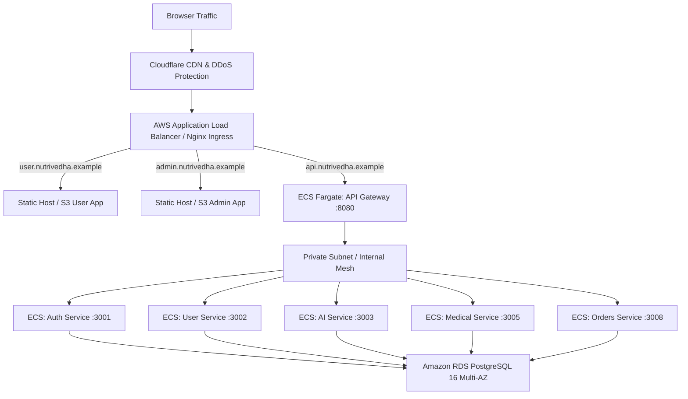

# NutriVedha — CORS & Deployment Architecture

## 1. Domain & Deployment Topology

The User and Admin frontends, along with the API Gateway, are designed as **separately deployable artifacts**.

```text
Production Domain Topology:
├── User Frontend:       https://user.nutrivedha.example
├── Admin Frontend:      https://admin.nutrivedha.example
└── API Gateway:         https://api.nutrivedha.example
```

---

## 2. Cross-Origin Resource Sharing (CORS) Policy
In production, wildcard origins (`*`) are strictly forbidden. The API Gateway validates origins against an explicit whitelist configured via environment variables.

### Gateway CORS Configuration
```typescript
import cors from 'cors';

const allowedOrigins = process.env.CORS_ALLOWED_ORIGINS 
  ? process.env.CORS_ALLOWED_ORIGINS.split(',') 
  : ['http://localhost:5173', 'http://localhost:5174'];

export const corsMiddleware = cors({
  origin: (origin, callback) => {
    // Allow non-browser requests (like mobile apps or curl in development)
    if (!origin || allowedOrigins.includes(origin)) {
      callback(null, true);
    } else {
      callback(new Error(`CORS blocked for origin: ${origin}`));
    }
  },
  credentials: true,
  methods: ['GET', 'POST', 'PUT', 'PATCH', 'DELETE', 'OPTIONS'],
  allowedHeaders: ['Content-Type', 'Authorization', 'X-Request-ID'],
  maxAge: 86400, // 24 hours pre-flight caching
});
```

---

## 3. Containerized Deployment Strategy (Docker)
Every component (Gateway, 10 Microservices, 2 Frontends, PostgreSQL) contains an optimized multi-stage `Dockerfile`:

- **Stage 1 (Build)**: Node 22 Alpine, compiles TypeScript to JavaScript, generates Prisma Client.
- **Stage 2 (Runtime)**: Minimal Node 22 Alpine image, copies compiled `/dist` and production `node_modules`, drops root privileges to `USER node`.

### Production Deployment Topology

