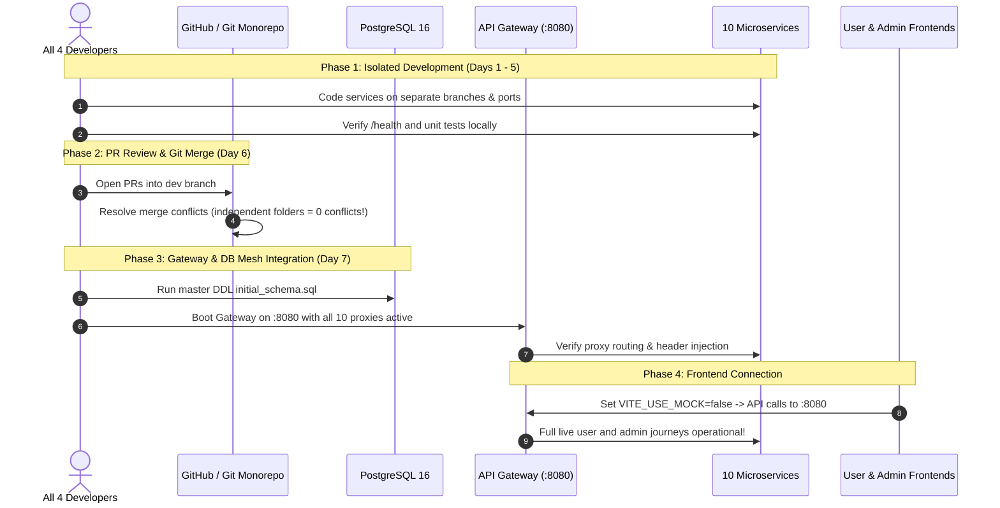

# 👥 NutriVedha — 4-Member Backend Engineering Task Division & Integration Blueprint

> **Architecture Reference**: Microservices Monorepo (`backend/services/*`, `backend/gateway`, `backend/shared`)  
> **Target Database**: Centralized PostgreSQL 16 Cluster (`database/schema/initial_schema.sql`)  
> **Development Strategy**: **100% Zero-Blocker Independent Parallel Development**, followed by clean contract-driven merging.

---

## 🧭 Executive Summary & Parallel Execution Strategy

To ensure all 4 backend team members can work **completely in parallel without waiting for one another**, the system enforces three architectural rules:

1. **Independent Port & Service Allocation**: Each microservice runs on its own isolated port with its own `package.json`, `src/index.ts`, and database tables.
2. **Standardized Gateway Header Contract**: 
   - Downstream services **never validate raw passwords or issue JWTs**.
   - Instead, the API Gateway validates the JWT and injects standardized downstream headers:
     - `x-user-id: <uuid>` (Authenticated patient or administrator ID)
     - `x-user-role: <string>` (`USER`, `SUPER_ADMIN`, `SYSTEM_OPERATOR`, etc.)
     - `x-request-id: <uuid>` (Unique correlation trace ID)
   - **For Local Independent Development**: Developers simply pass `x-user-id: 11111111-1111-1111-1111-111111111111` in Postman/Curl. They **do not need the Auth Service running** to build or test their modules!
3. **Dedicated Table Ownership**: Each developer owns a discrete set of PostgreSQL tables. No developer touches or modifies tables owned by another member.

```mermaid
graph TD
    subgraph ClientLayer["Frontend Layer (Port 5173 & 5174)"]
        UserApp["User Web App (:5173)"]
        AdminApp["Admin Console (:5174)"]
    end

    subgraph Member1["👤 MEMBER 1: Gateway & Core Identity"]
        GW["API Gateway (:8080)"]
        AuthSvc["Auth Service (:3001)"]
        UserSvc["User Service (:3002)"]
    end

    subgraph Member2["👤 MEMBER 2: Clinical AI & Telemedicine"]
        AISvc["AI Service (:3003)"]
        MedSvc["Medical Vault (:3005)"]
        TeleSvc["Telemedicine (:3006)"]
    end

    subgraph Member3["👤 MEMBER 3: Organic Commerce & Orders"]
        MktSvc["Marketplace (:3007)"]
        OrderSvc["Orders & Tracking (:3008)"]
    end

    subgraph Member4["👤 MEMBER 4: Telemetry & Engagement"]
        FitSvc["Fitness & Yoga (:3009)"]
        NotifSvc["Notifications (:3010)"]
        AnalyticsSvc["Analytics & Audit (:3011)"]
    end

    subgraph DBLayer["PostgreSQL 16 Multi-Tenant Cluster (:5432)"]
        DB[(PostgreSQL 16)]
    end

    UserApp --> GW
    AdminApp --> GW

    GW -->|Forward with x-user-id| AuthSvc
    GW -->|Forward with x-user-id| UserSvc
    GW -->|Forward with x-user-id| AISvc
    GW -->|Forward with x-user-id| MedSvc
    GW -->|Forward with x-user-id| TeleSvc
    GW -->|Forward with x-user-id| MktSvc
    GW -->|Forward with x-user-id| OrderSvc
    GW -->|Forward with x-user-id| FitSvc
    GW -->|Forward with x-user-id| NotifSvc
    GW -->|Forward with x-user-id| AnalyticsSvc

    AuthSvc --> DB
    UserSvc --> DB
    AISvc --> DB
    MedSvc --> DB
    TeleSvc --> DB
    MktSvc --> DB
    OrderSvc --> DB
    FitSvc --> DB
    NotifSvc --> DB
    AnalyticsSvc --> DB

    style Member1 fill:#F7F5EF,stroke:#35483A,stroke-width:2px
    style Member2 fill:#F1EBDD,stroke:#737B52,stroke-width:2px
    style Member3 fill:#E9E1D3,stroke:#806B55,stroke-width:2px
    style Member4 fill:#D5C3A5,stroke:#34342F,stroke-width:2px
```



---

## 📋 High-Level Work Distribution Matrix

| Member | Focus Domain | Assigned Microservices | Port | Owned Database Tables | External Integrations |
|---|---|---|---|---|---|
| **Member 1** | **Identity, Security & Ingress** | 1. API Gateway<br/>2. Auth Service<br/>3. User Service | `8080`<br/>`3001`<br/>`3002` | `users`, `admin_accounts`, `roles`, `permissions`, `refresh_tokens`, `user_profiles`, `user_addresses`, `user_preferences` | JWT, Bcrypt, Helmet, Reverse Proxy |
| **Member 2** | **Clinical Intelligence & HealthTech** | 1. AI Service<br/>2. Medical Service<br/>3. Telemedicine Service | `3003`<br/>`3005`<br/>`3006` | `ai_requests`, `diet_plans`, `saved_recipes`, `medical_reports`, `doctor_profiles`, `appointments` | Google Gemini API, AES-256-GCM Crypto |
| **Member 3** | **Organic Commerce & Supply Chain** | 1. Marketplace Service<br/>2. Orders Service | `3007`<br/>`3008` | `product_categories`, `products`, `wishlists`, `carts`, `orders`, `order_items`, `payments`, `tracking_events` | ACID SQL Transactions, Logistics Milestones |
| **Member 4** | **Observability, Operations & Alerts** | 1. Fitness Service<br/>2. Notification Service<br/>3. Analytics & Audit Service | `3009`<br/>`3010`<br/>`3011` | `fitness_logs`, `notifications`, `audit_logs`, `activity_events`, `system_settings` | Service Mesh Health Poller, Broadcast Engine |

---

# 👤 MEMBER 1: Core Identity, Security & Access Gateway
> **Role Title**: Lead Security & Ingress Engineer  
> **Git Branch**: `feat/member1-identity-gateway`  
> **Assigned Directory Paths**:
> - `backend/gateway/` (Port `8080`)
> - `backend/services/auth/` (Port `3001`)
> - `backend/services/user/` (Port `3002`)

---

### Module 1A: API Gateway Reverse Proxy (`backend/gateway`)
- **Port**: `8080`
- **Purpose**: Acts as the single entrance door to the NutriVedha platform. Shields internal microservices, prevents public exposure of ports, terminates CORS, enforces IP rate limits, verifies access tokens, and injects user identity into downstream headers.
- **Key Features**:
  - Ingress reverse proxy routing to all 10 downstream microservices.
  - Rate limiting (100 req/15 min default; 5 req/15 min for authentication routes).
  - Security headers via `helmet` and strict multi-origin CORS.
  - JWT verification middleware: Extracts `Bearer <token>`, decodes claims, rejects expired tokens, and forwards `x-user-id`, `x-user-role`, and `x-request-id` to microservices.
  - Public route bypass list: `/api/v1/auth/*`, `/api/v1/marketplace/products*`, `/api/v1/telemedicine/doctors*`, `/health`.
- **Requirements & Tech Stack**:
  - `express`, `http-proxy-middleware`, `express-rate-limit`, `helmet`, `cors`, `jsonwebtoken`.
- **Owned Database Tables**: *None (Completely Stateless).*

---

### Module 1B: Auth Service (`backend/services/auth`)
- **Port**: `3001`
- **Purpose**: Complete enterprise authentication provider for patients and administrative operators.
- **Key Features**:
  - User Registration: Validates phone/email uniqueness, hashes password with `bcryptjs` (salt factor 10), creates `users` record with role `USER` (prevents self-assignment of `ADMIN`).
  - User & Admin Login: Validates credentials, verifies `is_active = TRUE`, writes a row into `refresh_tokens`, returns short-lived access token (15 mins) and refresh token (7 days).
  - Refresh Token Rotation: Single-use token exchange. Revokes previous token and issues a new pair to prevent replay attacks.
  - Session Revocation (Logout): Flags `is_revoked = TRUE` in `refresh_tokens`.
- **Requirements & Tech Stack**:
  - `bcryptjs`, `jsonwebtoken`, `pg`, `zod`.
- **Owned Database Tables**:
  - `roles`, `permissions`, `role_permissions`, `users`, `admin_accounts`, `refresh_tokens`.

---

### Module 1C: User Service (`backend/services/user`)
- **Port**: `3002`
- **Purpose**: Patient profile management, Ayurvedic dosha constitution recording, address book, and administrative account moderation.
- **Key Features**:
  - Profile Management: `GET /api/v1/users/profile`, `PUT /api/v1/users/profile` (Gender, DOB, Height, Weight, Blood Group, Prakriti primary/secondary dosha).
  - Multi-Address CRUD: `GET /addresses`, `POST /addresses`, `DELETE /addresses/:id` (with `is_default` flag management).
  - Preferences: Dietary preferences (Vegetarian, Vegan, Sattvic) and allergies array.
  - Admin Moderation Endpoint: `PATCH /api/v1/users/:id/status` (Sets `is_active` to `FALSE` for account suspension).
- **Requirements & Tech Stack**:
  - `pg`, `zod`.
- **Owned Database Tables**:
  - `user_profiles`, `user_addresses`, `user_preferences`.

---

### Step-by-Step "How to Do" for Member 1:
1. **Database Baseline**: Run `database/schema/initial_schema.sql` on local PostgreSQL.
2. **Auth Service Implementation**:
   - `src/validators/auth.validator.ts`: Define Zod schemas for register, login, refresh.
   - `src/repositories/auth.repository.ts`: Write SQL queries for `findByEmail`, `createUser`, `createRefreshToken`, `revokeToken`.
   - `src/services/auth.service.ts`: Implement bcrypt compare, JWT sign (`jwt.sign({ id, role }, JWT_SECRET, { expiresIn: '15m' })`).
   - `src/controllers/auth.controller.ts`: Handle HTTP request/response envelopes.
   - `src/routes/auth.routes.ts`: Map endpoints: `POST /register`, `POST /login`, `POST /refresh`, `POST /logout`.
3. **User Service Implementation**:
   - Follow the same controller-service-repository pattern for `user_profiles`, `user_addresses`.
4. **Gateway Implementation**:
   - In `backend/gateway/src/index.ts`, configure `http-proxy-middleware` targets:
     ```typescript
     createProxyMiddleware({ target: 'http://localhost:3001', changeOrigin: true })
     ```
   - Add auth middleware that injects `req.headers['x-user-id'] = decoded.id`.

### Dependencies & Mocking during Parallel Phase:
- **Depends on**: None. Member 1 is the baseline provider.
- **Provides to Others**: The JWT token schema. Member 1 provides other members with the standard header format:
  ```http
  x-user-id: 11111111-1111-1111-1111-111111111111
  x-user-role: USER
  ```

---

# 👤 MEMBER 2: Clinical Intelligence, AI & Encrypted Medical Vault
> **Role Title**: HealthTech AI & Cryptography Specialist  
> **Git Branch**: `feat/member2-clinical-ai-telemed`  
> **Assigned Directory Paths**:
> - `backend/services/ai/` (Port `3003`)
> - `backend/services/medical/` (Port `3005`)
> - `backend/services/telemedicine/` (Port `3006`)

---

### Module 2A: AI Service (`backend/services/ai`)
- **Port**: `3003`
- **Purpose**: Powers multimodal Ayurvedic clinical intelligence: Gemini-based symptom analysis, offline rule-based diagnostic fallbacks, 7-day Prakriti meal plans, and pantry recipe generation.
- **Key Features**:
  - Symptom Screening (`POST /api/v1/ai/scan`): Takes symptom text description and optional image URL. Calls Google Gemini API. Analyzes dosha imbalance (Vata/Pitta/Kapha), recommended herbs, and urgency level.
  - Offline Fallback Engine: If Gemini API fails or network is offline, deterministically invokes classical rule-based heuristics (`is_fallback: true`) to ensure 100% platform availability.
  - 7-Day Diet Generation (`POST /api/v1/ai/diet/generate`): Synthesizes day-by-day Ayurvedic breakfast, lunch, and dinner plans aligned with patient's budget limit and dosha.
  - Saved Recipes (`GET /api/v1/ai/recipes`, `POST /api/v1/ai/recipes`): Bookmarks personalized recipes.
- **Requirements & Tech Stack**:
  - Google Gemini API (`@google/genai` or direct REST fetch), `pg`, `zod`.
- **Owned Database Tables**:
  - `ai_requests`, `diet_plans`, `saved_recipes`.

---

### Module 2B: Medical Service (`backend/services/medical`)
- **Port**: `3005`
- **Purpose**: Clinical records vault implementing cryptographic security at rest for patient diagnostics, lab reports, and prescriptions.
- **Key Features**:
  - AES-256-GCM Encryption: Every uploaded report payload is encrypted before insertion using a 256-bit key, a unique 16-byte random IV, and an authentication tag.
  - Encrypted Storage (`POST /api/v1/medical/reports`): Stores `encrypted_data`, `iv`, `auth_tag`, `report_title`, and `file_reference`.
  - Authenticated Decryption (`GET /api/v1/medical/reports/:id`): Retrieves record, verifies authentication tag (tamper detection), decrypts payload, and returns plaintext report.
  - Secure Deletion: Completely purges record on request.
- **Requirements & Tech Stack**:
  - Node.js native `crypto` module (`createCipheriv`, `createDecipheriv`, `randomBytes`), `pg`, `zod`.
- **Owned Database Tables**:
  - `medical_reports`.

---

### Module 2C: Telemedicine Service (`backend/services/telemedicine`)
- **Port**: `3006`
- **Purpose**: Practitioner directory discovery and patient consultation booking.
- **Key Features**:
  - Doctor Directory (`GET /api/v1/telemedicine/doctors`): Filterable by specialization (Panchakarma, Nadi Pariksha, Kayachikitsa), experience, rating, and fee.
  - Appointment Booking (`POST /api/v1/telemedicine/appointments`): Creates appointment linked to `doctor_id` and `user_id`.
  - Appointment Status Lifecycle: `REQUESTED` -> `CONFIRMED` -> `COMPLETED` / `CANCELLED`.
  - Patient Appointment History (`GET /api/v1/telemedicine/appointments/my`).
- **Requirements & Tech Stack**:
  - `pg`, `zod`.
- **Owned Database Tables**:
  - `doctor_profiles`, `appointments`.

---

### Step-by-Step "How to Do" for Member 2:
1. **Cipher Utility in Medical Service**:
   - Create `src/utils/crypto.ts`:
     ```typescript
     export function encrypt(text: string, secretKey: string) { ... }
     export function decrypt(encryptedText: string, iv: string, authTag: string, secretKey: string) { ... }
     ```
2. **AI Service Implementation**:
   - `src/services/gemini.service.ts`: Setup Gemini client with fallback try/catch.
   - `src/services/fallback.service.ts`: Implement deterministic Ayurvedic symptom matrix lookup.
3. **Telemedicine Service Implementation**:
   - Implement Doctor Profile listing and Appointment booking repository queries.

### Dependencies & Mocking during Parallel Phase:
- **Expects**: `req.headers['x-user-id']` for patient identity.
- **How to test independently**: Set header in Postman: `x-user-id: 22222222-2222-2222-2222-222222222222`. No need for Member 1's services to be running!

---

# 👤 MEMBER 3: Organic Commerce, Inventory & Logistics Engine
> **Role Title**: E-Commerce & Transactional Systems Specialist  
> **Git Branch**: `feat/member3-marketplace-orders`  
> **Assigned Directory Paths**:
> - `backend/services/marketplace/` (Port `3007`)
> - `backend/services/orders/` (Port `3008`)

---

### Module 3A: Marketplace Service (`backend/services/marketplace`)
- **Port**: `3007`
- **Purpose**: Powers the certified organic farm-to-home apothecary catalog, product categorization, stock levels, and active cart persistence.
- **Key Features**:
  - Catalog Browsing (`GET /api/v1/marketplace/products`): Paginated product listing with filters for category (Herbs, Oils, Ghee, Crops), organic certification, and price range.
  - Single Product Detail (`GET /api/v1/marketplace/products/:id`): Includes Ayurvedic dosha tags and available stock.
  - Persistent Cart Management (`GET /api/v1/marketplace/cart`, `PUT /api/v1/marketplace/cart`): Synchronizes patient's shopping cart in PostgreSQL `carts` table (`items JSONB`).
  - Wishlist Toggle (`POST /api/v1/marketplace/wishlist/:productId`).
- **Requirements & Tech Stack**:
  - `pg`, `zod`.
- **Owned Database Tables**:
  - `product_categories`, `products`, `wishlists`, `carts`.

---

### Module 3B: Orders Service (`backend/services/orders`)
- **Port**: `3008`
- **Purpose**: Executes atomic ACID checkout transactions and manages sequential farm-to-home milestone tracking.
- **Key Features**:
  - Transactional Checkout (`POST /api/v1/orders/checkout`):
    - Uses PostgreSQL transaction `BEGIN ... COMMIT / ROLLBACK`.
    - Verifies stock quantity for each item.
    - Decrements `products.stock_quantity`.
    - Inserts `orders` row with generated order number (`NV-2026-XXXX`).
    - Inserts line items in `order_items`.
    - Inserts payment settlement row in `payments`.
    - Inserts initial tracking event in `tracking_events` (`milestone = 'CONFIRMED'`).
  - Order History: `GET /api/v1/orders/my-orders`, `GET /api/v1/orders/:id`.
  - 5-Step Delivery Milestone Retrieval (`GET /api/v1/orders/:id/tracking`): Returns sequential milestone progression:
    1. `CONFIRMED` -> 2. `HARVESTED` -> 3. `PACKED` -> 4. `DISPATCHED` -> 5. `DELIVERED`.
  - Admin Milestone Transition: `PATCH /api/v1/orders/:id/status` (updates status and adds tracking event).
- **Requirements & Tech Stack**:
  - `pg` (with transaction client), `zod`.
- **Owned Database Tables**:
  - `orders`, `order_items`, `payments`, `tracking_events`.

---

### Step-by-Step "How to Do" for Member 3:
1. **Catalog Setup**: Seed `product_categories` and `products` from `database/seed/` or SQL script.
2. **Transactional Checkout in Orders Service**:
   - In `src/services/order.service.ts`:
     ```typescript
     const client = await pool.connect();
     try {
       await client.query('BEGIN');
       // 1. Check stock
       // 2. Decrement stock
       // 3. Insert into orders
       // 4. Insert into order_items
       // 5. Insert into payments
       // 6. Insert into tracking_events
       await client.query('COMMIT');
     } catch (err) {
       await client.query('ROLLBACK');
       throw err;
     } finally {
       client.release();
     }
     ```
3. **Milestone Retrieval**: Return milestone list sorted by `event_time ASC`.

### Dependencies & Mocking during Parallel Phase:
- **Expects**: `x-user-id` in request header, and a valid `delivery_address_id` in body.
- **How to test independently**: Use a mock UUID for address or pre-insert one dummy address into `user_addresses`.

---

# 👤 MEMBER 4: Telemetry, Observability & Engagement Engine
> **Role Title**: Observability, Analytics & Communications Engineer  
> **Git Branch**: `feat/member4-engagement-telemetry`  
> **Assigned Directory Paths**:
> - `backend/services/fitness/` (Port `3009`)
> - `backend/services/notification/` (Port `3010`)
> - `backend/services/analytics/` (Port `3011`)

---

### Module 4A: Fitness Service (`backend/services/fitness`)
- **Port**: `3009`
- **Purpose**: Manages circadian Dinacharya routines, yoga asanas, and daily workout activity streaks.
- **Key Features**:
  - Curated Routines Directory: Surya Namaskar, Pranayama, Kapha-balancing workouts.
  - Workout Logging (`POST /api/v1/fitness/logs`): Records completed routine, duration, calories burned.
  - Adherence Streak Calculation (`GET /api/v1/fitness/logs/my`): Aggregates user's consecutive day workout streak.
- **Requirements & Tech Stack**:
  - `pg`, `zod`.
- **Owned Database Tables**:
  - `fitness_logs`.

---

### Module 4B: Notification Service (`backend/services/notification`)
- **Port**: `3010`
- **Purpose**: Patient in-app notification center and administrative mass broadcast dispatcher.
- **Key Features**:
  - User Notification Feed (`GET /api/v1/notifications`): Returns paginated alerts (System, Wellness, Order).
  - Unread Count Poller (`GET /api/v1/notifications/unread-count`).
  - Read State Mutations (`PATCH /:id/read`, `PATCH /mark-all-read`).
  - Admin Mass Broadcast (`POST /api/v1/notifications/broadcast`): Dispatches alert to all users or specific cohorts.
- **Requirements & Tech Stack**:
  - `pg`, `zod`.
- **Owned Database Tables**:
  - `notifications`.

---

### Module 4C: Analytics & Audit Service (`backend/services/analytics`)
- **Port**: `3011`
- **Purpose**: Enterprise telemetry, immutable cryptographic audit logging, and service mesh health monitoring.
- **Key Features**:
  - Immutable Audit Ingestion (`POST /api/v1/analytics/audit-logs`): Logs administrative actions (actor, action, resource, target, metadata).
  - Audit Trail Query (`GET /api/v1/analytics/audit-logs`): Filterable by service name, date range, actor ID.
  - Aggregate Platform KPIs (`GET /api/v1/analytics/overview`): Aggregates total registrations, active orders, revenue totals.
  - Service Mesh Health Monitor (`GET /api/v1/analytics/health-status`): Periodically pings `/health` endpoints across all 11 services and calculates uptime %.
  - System Settings Key-Value Store (`GET /api/v1/analytics/settings`, `PUT /api/v1/analytics/settings`).
- **Requirements & Tech Stack**:
  - `pg`, `axios` (for polling peer service `/health` endpoints), `zod`.
- **Owned Database Tables**:
  - `audit_logs`, `activity_events`, `system_settings`.

---

### Step-by-Step "How to Do" for Member 4:
1. **Notification Feed**: Build standard CRUD repository for `notifications`.
2. **Audit Logging**: Create append-only repository for `audit_logs` (disallow `UPDATE` or `DELETE` SQL queries).
3. **Cluster Health Monitor**: Write utility that loops over `['http://localhost:3001/health', 'http://localhost:3002/health', ...]` with a 2-second timeout and returns an aggregated health scorecard.

### Dependencies & Mocking during Parallel Phase:
- **Expects**: `x-user-id` in header.
- **How to test independently**: Test endpoints directly using curl/Postman.

---

# 🔗 Step-by-Step Integration & Merging Protocol

Once each member completes their respective microservices, follow this systematic 4-phase integration protocol to merge everything into one cohesive platform:



### Integration Checkpoints:
1. **Contract Compatibility Verification**:
   - Ensure all responses conform to standard JSON envelope:
     ```json
     { "success": true, "data": { ... } }
     // OR
     { "success": false, "error": "Descriptive message" }
     ```
2. **Gateway Ingress Routing Test**:
   - Start Gateway on `:8080`.
   - Issue request to `http://localhost:8080/api/v1/auth/login` -> routes to `localhost:3001`.
   - Issue request to `http://localhost:8080/api/v1/marketplace/products` -> routes to `localhost:3007`.
   - Issue request to `http://localhost:8080/api/v1/ai/scan` -> routes to `localhost:3003`.
3. **Frontend Re-Connection**:
   - Open `frontend/user/.env` and `frontend/admin/.env`.
   - Change `VITE_USE_MOCK=true` to `VITE_USE_MOCK=false`.
   - Test login, AI symptom scanning, ordering, and admin management against the live backend!
