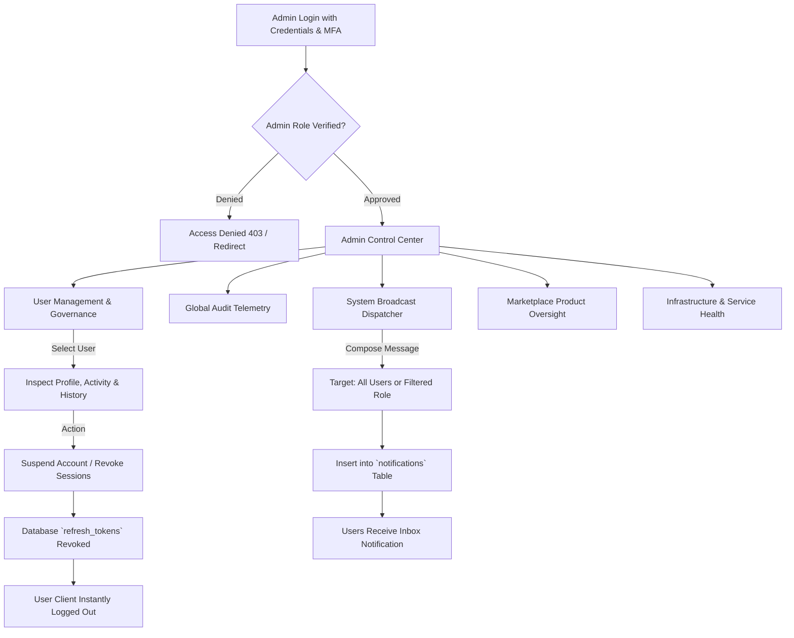

# NutriVedha — Admin Workflow Specification

## 1. High-Level Admin Governance Flow

---

## 2. Key Administrative Sub-Workflows

### A. User Account Governance & Immediate Suspension
1. Admin logs into `admin.nutrivedha.example` using credentials verified against `admin_accounts`.
2. Admin searches for a user by email, phone, or UUID in `/admin/users`.
3. Admin clicks **Suspend Account**:
   - Admin Frontend calls `POST /api/v1/users/:id/status` with `{ "isActive": false, "reason": "Policy violation" }`.
   - User Service updates `users.is_active = FALSE`.
   - User Service makes internal call to Auth Service: `DELETE /internal/v1/auth/sessions/user/:id`.
   - Auth Service updates `refresh_tokens.is_revoked = TRUE` for all sessions belonging to the user.
   - Analytics Service appends an `AUDIT_LOG` entry: `ADMIN_SUSPEND_USER`.
4. Subsequent requests by the user with their access token will be rejected upon token expiration (max 15 mins), and any attempt to refresh using the refresh token fails immediately with `401 Unauthorized`.

### B. System Broadcast Dispatch
1. Admin navigates to `/admin/broadcasts`.
2. Composes message: Title, Content, Category (`ANNOUNCEMENT`, `MAINTENANCE`, `HEALTH_TIP`), Target Cohort (`ALL_USERS`, `USERS_BY_DOSHA`).
3. Dispatches payload to Gateway -> Notification Service (`POST /api/v1/notifications/broadcast`).
4. Notification Service batch-inserts notification records for eligible users in PostgreSQL.
5. Emits audit log entry in Analytics Service.
6. When active users browse or poll `/api/v1/notifications`, the unread broadcast badge illuminates.

### C. Marketplace Product & Stock Moderation
1. Admin views `/admin/marketplace`.
2. Inspects product listings, pricing, organic certification flags, and inventory levels.
3. Modifies price, stock, or toggles `is_active` status.
4. Mutation commits to `products` table.
5. When users refresh the Marketplace, disabled products are filtered from the public catalog.
