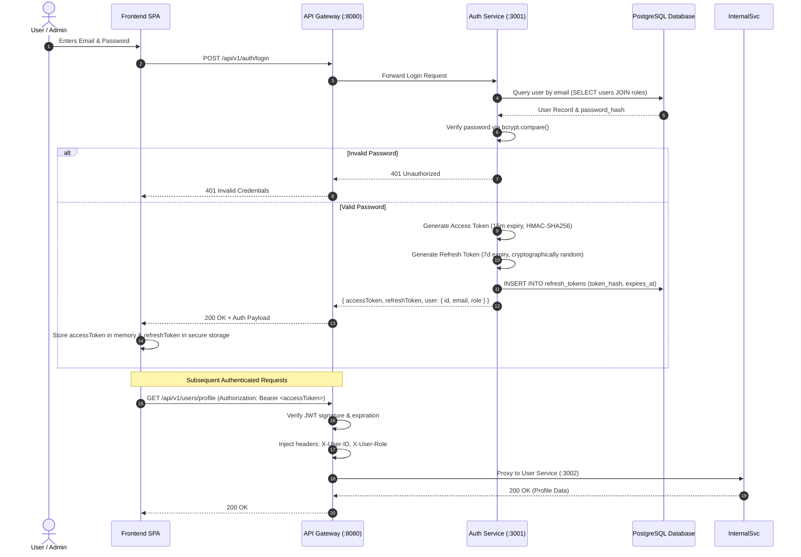
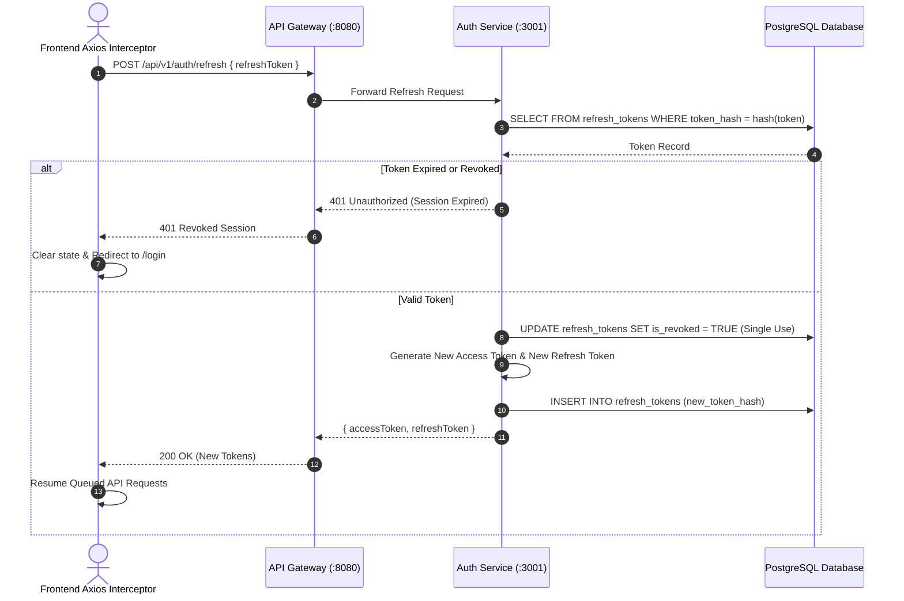

# NutriVedha — Authentication & Authorization Workflow

## 1. Authentication Architecture (JWT + Refresh Token Rotation)

NutriVedha implements a dual-token authentication scheme to ensure security without sacrificing performance.

---

## 2. Token Refresh & Rotation Flow

---

## 3. Role-Based Access Control (RBAC) Matrix

| Endpoint Route Pattern | Required Role | Unauthenticated | User Role | Admin Role |
|---|---|---|---|---|
| `POST /api/v1/auth/register` | Public | Allowed | Allowed | Allowed |
| `POST /api/v1/auth/login` | Public | Allowed | Allowed | Allowed |
| `GET /api/v1/users/profile` | Authenticated | 401 Unauthorized | Allowed | Allowed |
| `POST /api/v1/ai/scan` | Authenticated | 401 Unauthorized | Allowed | Allowed |
| `GET /api/v1/medical/reports` | Authenticated | 401 Unauthorized | Allowed (Own records) | 403 Forbidden |
| `GET /api/v1/marketplace/products` | Public | Allowed | Allowed | Allowed |
| `POST /api/v1/orders/checkout` | User | 401 Unauthorized | Allowed | 403 Forbidden |
| `GET /api/v1/analytics/overview` | Admin | 401 Unauthorized | 403 Forbidden | Allowed |
| `POST /api/v1/notifications/broadcast`| Admin | 401 Unauthorized | 403 Forbidden | Allowed |
| `POST /api/v1/users/:id/status` | Admin | 401 Unauthorized | 403 Forbidden | Allowed |
