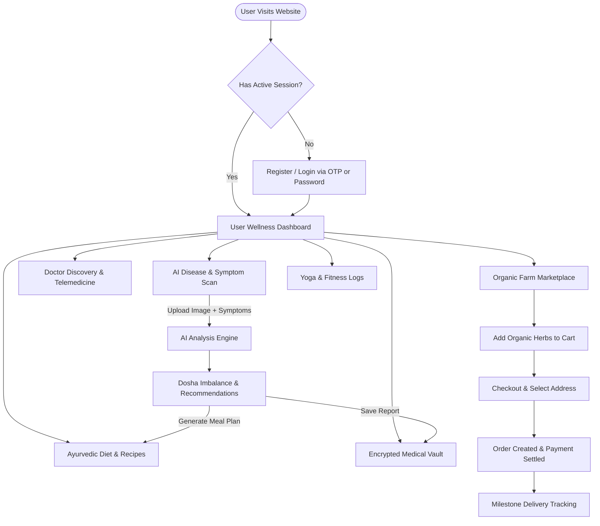

# NutriVedha — User Workflow Specification

## 1. End-to-End User Journey Map

---

## 2. Key User Sub-Workflows

### A. AI Disease & Symptom Screening
1. User navigates to `/scan`.
2. Uploads an image of skin concern / symptom or enters detailed text descriptions.
3. Frontend validates file format (`image/jpeg`, `image/png`, max 5MB) and dispatches multipart request to API Gateway (`POST /api/v1/ai/scan`).
4. Gateway enriches request with `X-User-ID` and proxies to AI Service (`:3003`).
5. AI Service submits payload to Gemini API (with prompt containing classical Ayurvedic diagnostic taxonomy).
6. In case of network interruption or API unavailability, deterministic rule-based fallback evaluates input symptoms against classical Ayurvedic symptom matrix.
7. Result is persisted to `ai_requests` table and returned to client with `isFallback` indicator.
8. User is prompted to bookmark or auto-save the analysis into their encrypted Medical Vault.

### B. Organic Marketplace Checkout & Delivery Tracking
1. User browses curated categories (`/marketplace`) with active search and dosha tags.
2. Selects products (e.g., Pure Kolar Ashwagandha, Amla Churna) and adjusts quantity.
3. Cart state updates in `useCartStore` and synchronizes to `carts` table.
4. User initiates checkout (`/checkout`), selects or adds a delivery address (`user_addresses`).
5. Orders Service validates inventory against Marketplace Service via transactional query.
6. Order is created with status `PENDING`, items recorded in `order_items`.
7. Payment gateway simulation records receipt in `payments` table and status transitions to `CONFIRMED`.
8. Initial tracking event `ORDER_PLACED` inserted into `tracking_events`.
9. User navigates to `/orders/:id/track` to view 5-step milestone tracking progress:
   - Step 1: Order Placed
   - Step 2: Processing & Herb Verification
   - Step 3: Dispatched from Farm Hub
   - Step 4: Out for Delivery
   - Step 5: Delivered to Doorstep
