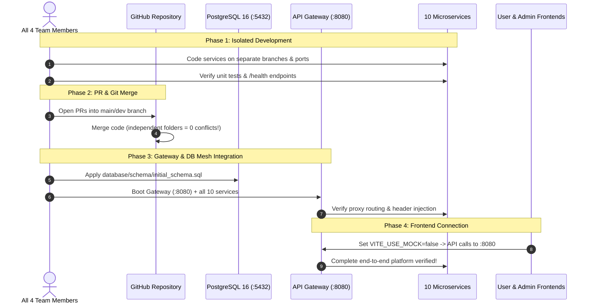

# 👥 NutriVedha — 4-Member Backend Engineering Task Allocation & Integration Blueprint

> **Project**: NutriVedha HealthTech Platform  
> **Architecture**: Microservices Monorepo (`backend/services/*`, `backend/gateway`, `backend/shared`)  
> **Target Database**: PostgreSQL 16 Multi-Tenant Cluster (`database/schema/initial_schema.sql`)  
> **Development Model**: **100% Zero-Blocker Independent Parallel Execution** -> **Contract-Driven Merge**

---

## 📑 Table of Contents

1. [Architectural Isolation & Zero-Blocker Strategy](#1-architectural-isolation--zero-blocker-strategy)
2. [Team Allocation Overview](#2-team-allocation-overview)
3. [👤 MEMBER 1: Identity, Security & Access Gateway](#3-member-1-identity-security--access-gateway)
4. [👤 MEMBER 2: Clinical AI, Telemedicine & Medical Vault](#4-member-2-clinical-ai-telemedicine--medical-vault)
5. [👤 MEMBER 3: Organic Commerce, Inventory & Orders Engine](#5-member-3-organic-commerce-inventory--orders-engine)
6. [👤 MEMBER 4: Telemetry, Observability & Engagement](#6-member-4-telemetry-observability--engagement)
7. [🔗 Inter-Service Communication Contracts](#7-inter-service-communication-contracts)
8. [🚀 Step-by-Step Integration & Merging Protocol](#8-step-by-step-integration--merging-protocol)
9. [🧪 End-to-End System Verification Checklist](#9-end-to-end-system-verification-checklist)

---

## 1. Architectural Isolation & Zero-Blocker Strategy

To enable all 4 developers to work on their respective microservices **at the exact same time without blocking each other**:

1. **Independent Process Execution**: Every service is a self-contained Express application on a dedicated port. Developers only need to run their assigned service(s) on their local machine.
2. **Stateless Identity Forwarding via Headers**:
   - In production, the API Gateway verifies the JWT and injects standardized downstream headers:
     - `x-user-id: <uuid>` (Current patient or administrator UUID)
     - `x-user-role: <string>` (`USER`, `SUPER_ADMIN`, `SYSTEM_OPERATOR`, etc.)
     - `x-request-id: <uuid>` (Unique correlation trace ID)
   - **For Independent Development**: Members 2, 3, and 4 **do not need the Auth Service or Gateway running**! They simply pass simulated test headers in Postman / Curl:
     ```http
     x-user-id: 11111111-1111-1111-1111-111111111111
     x-user-role: USER
     ```
3. **Strict Database Table Boundaries**:
   - Each developer owns dedicated tables defined in `database/schema/initial_schema.sql`.
   - Foreign keys to users (`user_id`) or products (`product_id`) are standard UUID columns. For unit/local testing, developers use mock UUIDs without cross-service table constraints blocking progress.

```mermaid
graph TD
    subgraph Client["Frontend Ingress"]
        UserUI["User Frontend (:5173)"]
        AdminUI["Admin Frontend (:5174)"]
    end

    subgraph M1["Member 1: Core Identity"]
        GW["API Gateway (:8080)"]
        Auth["Auth Service (:3001)"]
        User["User Service (:3002)"]
    end

    subgraph M2["Member 2: Clinical AI"]
        AI["AI Service (:3003)"]
        Med["Medical Vault (:3005)"]
        Tele["Telemedicine (:3006)"]
    end

    subgraph M3["Member 3: Commerce & Supply"]
        Mkt["Marketplace (:3007)"]
        Ord["Orders & Tracking (:3008)"]
    end

    subgraph M4["Member 4: Operations & Telemetry"]
        Fit["Fitness & Yoga (:3009)"]
        Notif["Notifications (:3010)"]
        Anl["Analytics & Audit (:3011)"]
    end

    subgraph DB["PostgreSQL 16 Cluster"]
        PG[(PostgreSQL 16)]
    end

    UserUI --> GW
    AdminUI --> GW

    GW -->|Forward with x-user-id| Auth
    GW -->|Forward with x-user-id| User
    GW -->|Forward with x-user-id| AI
    GW -->|Forward with x-user-id| Med
    GW -->|Forward with x-user-id| Tele
    GW -->|Forward with x-user-id| Mkt
    GW -->|Forward with x-user-id| Ord
    GW -->|Forward with x-user-id| Fit
    GW -->|Forward with x-user-id| Notif
    GW -->|Forward with x-user-id| Anl

    Auth --> PG
    User --> PG
    AI --> PG
    Med --> PG
    Tele --> PG
    Mkt --> PG
    Ord --> PG
    Fit --> PG
    Notif --> PG
    Anl --> PG

    style M1 fill:#F7F5EF,stroke:#35483A,stroke-width:2px
    style M2 fill:#F1EBDD,stroke:#737B52,stroke-width:2px
    style M3 fill:#E9E1D3,stroke:#806B55,stroke-width:2px
    style M4 fill:#D5C3A5,stroke:#34342F,stroke-width:2px
```



---

## 2. Team Allocation Overview

| Team Member | Engineering Domain | Assigned Microservices | Port | Owned Tables | Git Branch |
|---|---|---|---|---|---|
| **Member 1** | **Identity, Security & Gateway Ingress** | 1. API Gateway<br/>2. Auth Service<br/>3. User Service | `8080`<br/>`3001`<br/>`3002` | `users`, `admin_accounts`, `roles`, `permissions`, `role_permissions`, `refresh_tokens`, `user_profiles`, `user_addresses`, `user_preferences` | `feat/member1-identity-gateway` |
| **Member 2** | **Clinical AI, Diagnostics & Vault** | 1. AI Service<br/>2. Medical Service<br/>3. Telemedicine Service | `3003`<br/>`3005`<br/>`3006` | `ai_requests`, `diet_plans`, `saved_recipes`, `medical_reports`, `doctor_profiles`, `appointments` | `feat/member2-clinical-ai-telemed` |
| **Member 3** | **Organic Commerce & Supply Chain** | 1. Marketplace Service<br/>2. Orders Service | `3007`<br/>`3008` | `product_categories`, `products`, `wishlists`, `carts`, `orders`, `order_items`, `payments`, `tracking_events` | `feat/member3-marketplace-orders` |
| **Member 4** | **Observability, Operations & Alerts** | 1. Fitness Service<br/>2. Notification Service<br/>3. Analytics Service | `3009`<br/>`3010`<br/>`3011` | `fitness_logs`, `notifications`, `audit_logs`, `activity_events`, `system_settings` | `feat/member4-engagement-telemetry` |

---

## 3. 👤 MEMBER 1: Identity, Security & Access Gateway

### Module 1.1: API Gateway Reverse Proxy (`backend/gateway`)
- **Port**: `8080`
- **Purpose**: Unified perimeter defense, request routing, IP rate limiting, and JWT authentication gate.
- **Key Features**:
  - Reverse proxy dispatch to all 10 downstream microservices via `http-proxy-middleware`.
  - Rate limiting (100 req/15 min default; 5 req/15 min on login/register).
  - Security headers via `helmet` and multi-origin CORS (`localhost:5173` and `localhost:5174`).
  - Correlation ID injection (`x-request-id: <uuid>`).
  - JWT verification: Validates `Authorization: Bearer <token>`, extracts claims, and injects `x-user-id` and `x-user-role` headers into downstream requests.
  - Public route bypass list: `/api/v1/auth/*`, `/api/v1/marketplace/products*`, `/api/v1/telemedicine/doctors*`, `/health`.
- **Requirements & Stack**: `express`, `http-proxy-middleware`, `express-rate-limit`, `helmet`, `cors`, `jsonwebtoken`.
- **Owned Tables**: *None (Stateless).*

### Module 1.2: Auth Service (`backend/services/auth`)
- **Port**: `3001`
- **Purpose**: Identity credential verification, password hashing, and token issuance.
- **Key Features**:
  - User Registration (`POST /api/v1/auth/register`): Hashes password with `bcryptjs` (salt 10), creates row in `users`, default role `USER`. Prevents client-side privilege escalation.
  - User & Admin Login (`POST /api/v1/auth/login`, `POST /api/v1/auth/admin/login`): Validates email/password, issues short-lived JWT (15 mins), records refresh token in `refresh_tokens` (7 days).
  - Refresh Token Rotation (`POST /api/v1/auth/refresh`): Single-use exchange. Invalidates old refresh token and issues a new pair to prevent replay attacks.
  - Logout (`POST /api/v1/auth/logout`): Flags `is_revoked = TRUE` in `refresh_tokens`.
- **Requirements & Stack**: `bcryptjs`, `jsonwebtoken`, `pg`, `zod`.
- **Owned Tables**: `users`, `admin_accounts`, `roles`, `permissions`, `role_permissions`, `refresh_tokens`.

### Module 1.3: User Service (`backend/services/user`)
- **Port**: `3002`
- **Purpose**: Patient profiles, Ayurvedic Prakriti/Vikriti constitution records, and multi-address management.
- **Key Features**:
  - Profile Management (`GET /api/v1/users/profile`, `PUT /api/v1/users/profile`): Reads/updates height, weight, primary dosha (*Vata, Pitta, Kapha*), secondary dosha, and blood group.
  - Multi-Address CRUD (`GET /addresses`, `POST /addresses`, `DELETE /addresses/:id`): Supports multiple shipping addresses with an active default toggle.
  - Preferences (`GET /preferences`, `PUT /preferences`): Vegetarian, Vegan, allergies list.
  - Admin Account Moderation (`PATCH /api/v1/users/:id/status`): Suspends or restores patient accounts with immediate session invalidation.
- **Requirements & Stack**: `pg`, `zod`.
- **Owned Tables**: `user_profiles`, `user_addresses`, `user_preferences`.

### Step-by-Step "How to Do" for Member 1:
1. Initialize database connection pool using `pg.Pool` with connection credentials from `.env`.
2. In `backend/services/auth`:
   - `src/validators/auth.validator.ts`: Write Zod schemas for register, login, refresh.
   - `src/repositories/auth.repository.ts`: Write parameterized SQL queries for user lookup and refresh token insertion.
   - `src/services/auth.service.ts`: Implement bcrypt comparison and JWT issuance.
   - `src/controllers/auth.controller.ts`: Format responses into `{ success: true, data: { token, user } }`.
   - `src/routes/auth.routes.ts`: Map endpoints.
3. In `backend/services/user`: Implement profile and address endpoints using the same layered structure.
4. In `backend/gateway`: Configure proxy routes and JWT middleware.

---

## 4. 👤 MEMBER 2: Clinical AI, Telemedicine & Medical Vault

### Module 2.1: AI Service (`backend/services/ai`)
- **Port**: `3003`
- **Purpose**: Multimodal clinical AI symptom screening, classical Ayurvedic rule-based fallback, and 7-day Prakriti meal plan generation.
- **Key Features**:
  - Symptom Screening (`POST /api/v1/ai/scan`): Accepts symptom descriptions and image attachments. Invokes Google Gemini API. Extracts dosha imbalance (*Vata, Pitta, Kapha*), herbal suggestions, and clinical urgency.
  - Offline Rule-Based Fallback: If Gemini API is unreachable or fails, deterministically activates local rule lookup based on Charaka Samhita symptom tables (`is_fallback: true`) to ensure 100% platform availability.
  - 7-Day Diet Planner (`POST /api/v1/ai/diet/generate`): Synthesizes daily meal plans (breakfast, lunch, dinner) aligned with user's dosha and budget.
  - Recipe Generator & Bookmarks (`POST /api/v1/ai/recipes/recommend`, `POST /api/v1/ai/recipes/save`).
- **Requirements & Stack**: Google Gemini API, `pg`, `zod`.
- **Owned Tables**: `ai_requests`, `diet_plans`, `saved_recipes`.

### Module 2.2: Medical Service (`backend/services/medical`)
- **Port**: `3005`
- **Purpose**: Encrypted clinical medical vault ensuring zero unauthorized access to patient diagnostics.
- **Key Features**:
  - AES-256-GCM Encryption: Every uploaded report payload is encrypted before insertion using a 256-bit key, a unique 16-byte random IV, and a 128-bit authentication tag.
  - Report Upload (`POST /api/v1/medical/reports`): Stores `encrypted_data`, `iv`, `auth_tag`, `report_title`, and `file_reference`.
  - Authenticated Retrieval (`GET /api/v1/medical/reports/:id`): Verifies authentication tag (tamper detection), decrypts payload, and returns plaintext.
  - Secure Deletion (`DELETE /api/v1/medical/reports/:id`).
- **Requirements & Stack**: Node.js native `crypto` module, `pg`, `zod`.
- **Owned Tables**: `medical_reports`.

### Module 2.3: Telemedicine Service (`backend/services/telemedicine`)
- **Port**: `3006`
- **Purpose**: Ayurvedic doctor directory and teleconsultation appointment scheduling.
- **Key Features**:
  - Doctor Directory (`GET /api/v1/telemedicine/doctors`): Search and filter by specialization, experience, rating, and fee.
  - Appointment Booking (`POST /api/v1/telemedicine/appointments`): Creates appointment linked to `doctor_id` and `user_id`.
  - Appointment Status Lifecycle: `REQUESTED` -> `CONFIRMED` -> `COMPLETED` / `CANCELLED`.
  - Patient Consultations (`GET /api/v1/telemedicine/appointments/my`).
- **Requirements & Stack**: `pg`, `zod`.
- **Owned Tables**: `doctor_profiles`, `appointments`.

### Step-by-Step "How to Do" for Member 2:
1. In `backend/services/medical`: Implement `src/utils/crypto.ts` with `createCipheriv('aes-256-gcm', ...)` and `createDecipheriv('aes-256-gcm', ...)`.
2. In `backend/services/ai`:
   - `src/services/gemini.service.ts`: Wire Gemini client with prompt templates.
   - `src/services/fallback.service.ts`: Create classical Ayurvedic rule engine for offline symptom mapping.
3. In `backend/services/telemedicine`: Build doctor repository and appointment booking controller.
4. **Independent Testing**: Test endpoints directly on ports 3003, 3005, and 3006 by passing `x-user-id: 22222222-2222-2222-2222-222222222222`.

---

## 5. 👤 MEMBER 3: Organic Commerce, Inventory & Orders Engine

### Module 3.1: Marketplace Service (`backend/services/marketplace`)
- **Port**: `3007`
- **Purpose**: Certified organic herbal apothecary catalog, category taxonomies, and persistent user shopping carts.
- **Key Features**:
  - Catalog Browsing (`GET /api/v1/marketplace/products`): Paginated product listing with filters for category (Herbs, Oils, Ghee, Crops), organic certification, and price range.
  - Product Details (`GET /api/v1/marketplace/products/:id`): Returns Sanskrit botanical name, therapeutic dosha tags, and live stock count.
  - Active Cart Sync (`GET /api/v1/marketplace/cart`, `PUT /api/v1/marketplace/cart`): Synchronizes patient's shopping cart in PostgreSQL `carts` table (`items JSONB`).
  - Wishlist Toggle (`POST /api/v1/marketplace/wishlist/:productId`).
- **Requirements & Stack**: `pg`, `zod`.
- **Owned Tables**: `product_categories`, `products`, `wishlists`, `carts`.

### Module 3.2: Orders Service (`backend/services/orders`)
- **Port**: `3008`
- **Purpose**: Atomic checkout transaction processing and 5-step farm-to-home milestone tracking.
- **Key Features**:
  - Transactional Checkout (`POST /api/v1/orders/checkout`):
    - Uses PostgreSQL transaction `BEGIN ... COMMIT / ROLLBACK`.
    - Verifies stock quantity for each item.
    - Decrements `products.stock_quantity`.
    - Inserts `orders` row with generated order number (`NV-2026-XXXX`).
    - Inserts line items in `order_items`.
    - Inserts payment settlement row in `payments`.
    - Inserts initial tracking event in `tracking_events` (`milestone = 'CONFIRMED'`).
  - Order History: `GET /api/v1/orders/my-orders`, `GET /api/v1/orders/:id`.
  - 5-Step Milestone Tracking (`GET /api/v1/orders/:id/tracking`): Returns sequential milestone progression:
    1. `CONFIRMED` -> 2. `HARVESTED` -> 3. `PACKED` -> 4. `DISPATCHED` -> 5. `DELIVERED`.
  - Admin Logistics Milestone Update (`PATCH /api/v1/orders/:id/status`): Updates status and logs tracking event with carrier/AWB.
- **Requirements & Stack**: `pg` (with transaction client), `zod`.
- **Owned Tables**: `orders`, `order_items`, `payments`, `tracking_events`.

### Step-by-Step "How to Do" for Member 3:
1. Seed `product_categories` and `products` from `database/seed/` or SQL script.
2. Build product listing with pagination (`LIMIT`, `OFFSET`) and search filters (`ILIKE`).
3. In `backend/services/orders/src/services/order.service.ts`:
   - Implement transactional checkout:
     ```typescript
     const client = await pool.connect();
     try {
       await client.query('BEGIN');
       // 1. Verify and decrement stock
       // 2. Insert order
       // 3. Insert order_items
       // 4. Insert payment
       // 5. Insert tracking_event
       await client.query('COMMIT');
     } catch (err) {
       await client.query('ROLLBACK');
       throw err;
     } finally {
       client.release();
     }
     ```
4. **Independent Testing**: Test marketplace on `:3007` and orders on `:3008` by passing `x-user-id` in headers.

---

## 6. 👤 MEMBER 4: Telemetry, Observability & Engagement

### Module 6.1: Fitness Service (`backend/services/fitness`)
- **Port**: `3009`
- **Purpose**: Circadian Dinacharya lifestyle adherence, classical yoga asanas, and workout streak logging.
- **Key Features**:
  - Curated Routines Directory: Surya Namaskar, Pranayama, Kapha-balancing morning workouts.
  - Workout Logging (`POST /api/v1/fitness/logs`): Records completed routine, duration, calories burned.
  - Adherence Streak Calculation (`GET /api/v1/fitness/logs/my`): Computes consecutive active workout days.
- **Requirements & Stack**: `pg`, `zod`.
- **Owned Tables**: `fitness_logs`.

### Module 6.2: Notification Service (`backend/services/notification`)
- **Port**: `3010`
- **Purpose**: In-app patient alert inbox and administrative mass broadcast dispatcher.
- **Key Features**:
  - Patient Notification Feed (`GET /api/v1/notifications`): Returns paginated alerts (System, Wellness, Order).
  - Unread Count Poller (`GET /api/v1/notifications/unread-count`).
  - Read State Mutations (`PATCH /:id/read`, `PATCH /mark-all-read`).
  - Administrative Broadcast Dispatcher (`POST /api/v1/notifications/broadcast`): Dispatches mass alerts to all users or specific cohorts.
- **Requirements & Stack**: `pg`, `zod`.
- **Owned Tables**: `notifications`.

### Module 6.3: Analytics & Audit Service (`backend/services/analytics`)
- **Port**: `3011`
- **Purpose**: Enterprise administrative observability, immutable audit logging, and service mesh health monitoring.
- **Key Features**:
  - Immutable Audit Ingestion (`POST /api/v1/analytics/audit-logs`): Ingests administrative event logs (actor, action, resource, target, metadata). Append-only (no `UPDATE`/`DELETE`).
  - Audit Trail Query (`GET /api/v1/analytics/audit-logs`): Filterable by service name, date range, actor ID.
  - Platform Health Aggregator (`GET /api/v1/analytics/overview`): Aggregates total registrations, active orders, revenue volume.
  - Service Mesh Health Monitor (`GET /api/v1/analytics/health-status`): Periodically pings `/health` endpoints across all 11 services and calculates uptime %.
  - System Settings Key-Value Store (`GET /api/v1/analytics/settings`, `PUT /api/v1/analytics/settings`).
- **Requirements & Stack**: `pg`, `axios` (for polling peer `/health` endpoints), `zod`.
- **Owned Tables**: `audit_logs`, `activity_events`, `system_settings`.

### Step-by-Step "How to Do" for Member 4:
1. Build notification feed and mark-read controllers.
2. Build append-only audit repository (reject any `UPDATE` or `DELETE` SQL operations).
3. In `backend/services/analytics/src/services/health.service.ts`:
   - Write a function that loops through `['http://localhost:3001/health', 'http://localhost:3002/health', ...]` with a 2-second timeout and returns an aggregated status scorecard.
4. **Independent Testing**: Test fitness on `:3009`, notifications on `:3010`, and analytics on `:3011` using curl/Postman.

---

## 7. 🔗 Inter-Service Communication Contracts

### Contract 1: Standard API Response Envelope
Every microservice endpoint must return this uniform structure:
```json
// Success Response (HTTP 200/201)
{
  "success": true,
  "data": { ... }
}

// Error Response (HTTP 400/401/403/404/500)
{
  "success": false,
  "error": "Human-readable error description",
  "code": "VALIDATION_FAILED"
}
```

### Contract 2: Downstream Ingress Headers
When calling any microservice through the API Gateway, these headers are automatically present:
```http
x-user-id: 3fa85f64-5717-4562-b3fc-2c963f66afa6
x-user-role: USER
x-request-id: 9b1deb4d-3b7d-4bad-9bdd-2b0d7b3dcb6d
```

### Contract 3: Standard Health Check Endpoint
Every microservice exposes a public, unauthenticated `GET /health` endpoint:
```json
{
  "service": "marketplace",
  "status": "UP",
  "port": 3007,
  "timestamp": "2026-11-26T07:30:00.000Z",
  "uptimeSeconds": 3420
}
```

---

## 8. 🚀 Step-by-Step Integration & Merging Protocol

Once each member completes their individual services, execute the following 4-phase merge:



### Day-by-Day Integration Schedule:

- **Days 1 to 5 (Parallel Execution)**:
  - Each developer writes controllers, services, repositories, and Zod validators in their assigned directories.
  - Each developer tests their endpoints locally with simulated headers.
- **Day 6 (Pull Requests & Monorepo Merge)**:
  - Each member pushes their branch:
    - Member 1: `feat/member1-identity-gateway`
    - Member 2: `feat/member2-clinical-ai-telemed`
    - Member 3: `feat/member3-marketplace-orders`
    - Member 4: `feat/member4-engagement-telemetry`
  - Merge into `dev` branch. Because each member worked in separate folders under `backend/services/*`, **merge conflicts will be virtually zero**.
- **Day 7 (Mesh Verification & Frontend Switch)**:
  - Run `npm run db:up` to spin up PostgreSQL.
  - Apply `database/schema/initial_schema.sql`.
  - Run `npm run dev:backend` from root to launch the Gateway and all 10 services concurrently.
  - Switch `frontend/user/.env` and `frontend/admin/.env` to `VITE_USE_MOCK=false`.
  - Both frontends now talk to the live microservice cluster through the Gateway on `:8080`!

---

## 9. 🧪 End-to-End System Verification Checklist

- [ ] **Auth Journey**: Member 1's Auth registers a new user -> Gateway issues JWT -> Gateway decodes and forwards `x-user-id`.
- [ ] **Clinical AI Journey**: User submits symptom scan -> Member 2's AI Service evaluates symptoms via Gemini or offline fallback -> user saves report -> Medical Service encrypts with AES-256-GCM.
- [ ] **Commerce Journey**: User browses Member 3's Marketplace catalog -> adds herb to cart -> checks out -> Orders Service executes atomic SQL transaction and writes milestone event.
- [ ] **Operations Journey**: Admin logs in via Member 1's Auth -> broadcasts notice via Member 4's Notification Service -> checks service mesh uptime on Member 4's Analytics Service -> inspects Member 4's immutable audit log.
